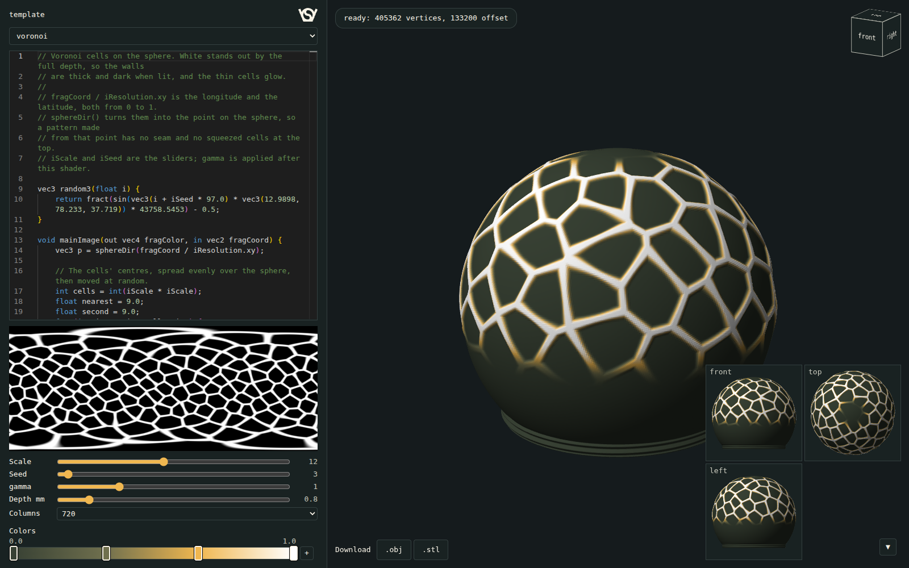

# Mathematical spheres

Webapp: a shader, as in Shadertoy, draws a heightmap, and its brightness moves the outside of V2's sphere. Downloads `.stl` and `.obj`. Open `index.html` in a browser; no install, no server. Original description: `readme_hgc.md`.

| File | What |
|---|---|
| `index.html` | layout |
| `app.js` | editor, heightmap, 3D views, colours, downloads |
| `sphere_mesh.js` | `sphere_mesh()` of `../pucklight_sphereV2.scad` in JavaScript; copy changes over by hand |
| `test_sphere_mesh.js` | `node test_sphere_mesh.js` compares it with OpenSCAD's export; needs `openscad` |

## Controls

| Control | Generator's name | Does |
|---|---|---|
| Scale, Seed | | `iScale`, `iSeed` in the shader |
| gamma | | height = brightness ^ gamma, after the shader |
| Depth mm | `surface_depth` | how far 1.0 stands out |
| Columns | `sphere_columns` | mesh resolution, see below |
| Colors | | height to colour: the preview and the `.obj`. Two stops on one place make a hard edge |

3D view: drag to orbit, wheel to zoom, cube to jump to a side, arrow to hide the small views.

## Shader

| Name | Is |
|---|---|
| `mainImage(out vec4 fragColor, in vec2 fragCoord)` | as in Shadertoy; a pasted shader compiles as it is, without `iChannel` and buffers |
| `fragCoord / iResolution.xy` | longitude and latitude, 0 to 1; x = 0 lies on the mesh's +x side, y = 1 at the top |
| `sphereDir(uv)` | the point on the unit sphere: no seam, no squeezed cells at the top |
| `iScale`, `iSeed` | the sliders |
| `iTime`, `iFrame`, `iMouse` | always 0 |
| Map | 1024 x 512, 8 bit, brightness = 0.299 r + 0.587 g + 0.114 b |

- Without `sphereDir()`, a pattern must repeat from left to right, or it shows a seam on the +x side.
- A new template: add a line to `templates` in `app.js`.
- With a shader error, the status and the editor show the line, and the last good sphere stays.

## What moves

As `outer_radius()` in the generator, with the map as `surface_height()`: radius = `sphere_r` + depth x `surface_fade(lat)` x height.

| Part | Latitude | Moves |
|---|---|---|
| Thread, neck | | no |
| Inside | | no |
| Outside, lower part | -37.8 to -12.5 | no |
| Outside, fading in | -12.5 to 2.5 | partly |
| Outside | 2.5 to 65 | fully |
| Outside, fading out | 65 to 80 | partly |
| Top, pole | 80 to 90 | no |

Colour follows the movement: a point that stays gets the colour of 0.0, also the neck and the inside.

## Columns

| Columns | Step at the equator | Vertices | Offset | Triangles | `.stl` | Voronoi walls |
|---|---|---|---|---|---|---|
| 180 | 1.75 mm | 32222 | 8280 | 64440 | 3.2 MB | coarse stair-steps |
| 360 | 0.87 mm | 110522 | 33120 | 221040 | 11.1 MB | visible stair-steps |
| **720** | **0.44 mm** | **405362** | **133200** | **810720** | **40.5 MB** | **clean; the default and the generator's maximum** |

## Checks

| Check | Result |
|---|---|
| `test_sphere_mesh.js`: smooth at 64 and 180 columns, `twist` at 180 | same points within 0.0001 mm, same faces in the same direction, closed |
| The generator's `twist` typed as a shader, downloaded, against OpenSCAD's `surface = "twist"` | worst point 0.0013 mm off |
| Voronoi, 720 columns, against OpenSCAD's smooth sphere | not one point of the thread, neck or inside moved |
| Same, read back by Blender | `.stl` and `.obj`: 0 non-manifold edges, 26.0 cm3 (smooth: 22.0), 32 g of PLA by volume |
| `.obj` in Blender | vertex colours arrive |
| Every control in headless Chrome: mouse and typing on the cube, orbit, zoom, stops, picker and editor; sliders and lists set by script | works, console clean |
| Without the internet | a plain text box replaces the editor; the rest works |

## Not tested yet

- Not sliced, not printed. Most open: overhang on the lower flank of a wall.
- Only on software WebGL in Chrome: no real GPU, no Firefox. One update took 0.2 to 1.6 s there.

## Not included

- `vase_sphere`: this is V2's normal sphere, whose inside stays smooth, so thickness makes the pattern when lit.
- Saving: a reload starts from the template again, so copy your shader out.
- Logo: none on the sphere, as in V2 by default; the sockel and the click base carry it.

Licensed under GPL.
