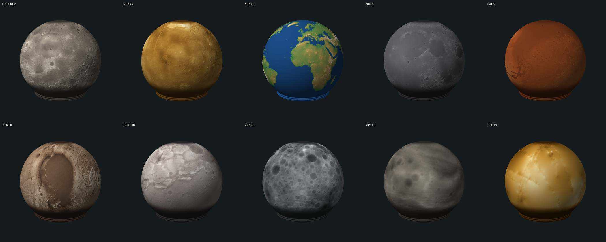

# Planets

Elevation maps of ten bodies, each a project of the webapp in `../mathematical/`: pick it in the project list. Links: `planetary_heightmaps.md`. Original description: `readme_hgc.md`.

| Project | Source | Download | Map's middle | Known | Made with |
|---|---|---|---|---|---|
| Mercury | USGS, MESSENGER DEM 665 m | 531 MB | 180° | all | |
| Venus | USGS, Magellan topography 4641 m | 67 MB | 0° | 92% | gamma 0.5 |
| Earth | NASA, GEBCO 08 topography, 5400 x 2700 | 15 MB | 0° | land only: oceans are flat | gamma 0.45 |
| Moon | NASA SVS, CGI Moon Kit, LOLA 16 px/deg | 33 MB | 0° (no tag; seen from its maria) | all | |
| Mars | USGS, MOLA DEM 463 m | 2126 MB | 0° | all | |
| Pluto | USGS, New Horizons DEM 300 m | 620 MB | 180° | 46.5%: one hemisphere | |
| Charon | USGS, New Horizons DEM 300 m | 161 MB | 0° | 45.7%: one hemisphere | |
| Ceres | USGS, Dawn HAMO DTM 137 m | 467 MB | 180° | all | flatten |
| Vesta | USGS, Dawn HAMO DTM 93 m | 597 MB | 0° | all | flatten |
| Titan | USGS, Cassini GTDR, model `GTI` | 269 MB | 0° | interpolated: see below | |

Not here: Jupiter, Saturn, Uranus, Neptune have no solid surface, so no measured height exists.

All projects: `texture` template, `From lat` -36, depth 0.8 mm, 720 columns. The middle of each map faces the sphere's front, so Pluto and Charon show the side that was measured.

## How a map is made

Run `python3 make_planet_projects.py [names]`; needs numpy, Pillow and curl. Downloads 4.6 GB into `.gitignored/raw/`, out of git. An existing project stays as it is: delete it to make it again.

| Step | Why |
|---|---|
| Area average to 2048 x 1024, 8 bit, about 0.5 MB | the app's map has 1024 x 512; at 5 mm depth a step is 0.02 mm, far below a 0.2 mm layer |
| Stretch from the 0.1 to the 99.9 percentile | a few extreme points, like the Himalaya, must not flatten the rest |
| No data: level at the median height | the edge of what was measured is no cliff |
| flatten: less each latitude's median | Ceres and Vesta are flattened bodies measured from a sphere: a broad belt around the equator drowned the craters |

## Differences from `planetary_heightmaps.md`

| Body | There | Here | Why |
|---|---|---|---|
| Earth | `visibleearth.nasa.gov`, 21600 x 10800 PNG | `assets.science.nasa.gov`, 5400 x 2700 TIFF | the page has moved to `science.nasa.gov`; the old image address did not answer when tried |
| Earth | Wikimedia's land and sea floor map | not used | its page says CC BY-SA 4.0, not public domain; and land alone reads well |
| Moon | USGS 8 GB | Moon Kit, 33 MB | same LOLA data; a map of 2048 is enough |
| Mars | Planet Pixel Emporium, or USGS | USGS | the measured data from a public source; that site's terms were not checked |
| Vesta, Titan | a page | its file | found on the page |
| Longitude | "Mars is centred on 180" | Mars's file says 0; Mercury, Ceres, Pluto say 180 | read from each file's GeoTIFF tags |

## Know before printing

- Titan: the lines follow Cassini's radar tracks. Between them is interpolation, so most of what you see is not landscape.
- Pluto, Charon: the smooth part was never measured.
- Venus: the gaps are level at the median.
- The relief starts at -36 and V3's sphere at -45, so the far south is not on any sphere. `From lat` reaches -43, with more overhang: `../mathematical/readme.md`, Overhang.
- Not sliced, not printed.

Sources: NASA and USGS, with GEBCO for Earth's data, Cassini RADAR team and Lorenz et al. 2013 for Titan. Credit them; the data is not under this project's GPL.
