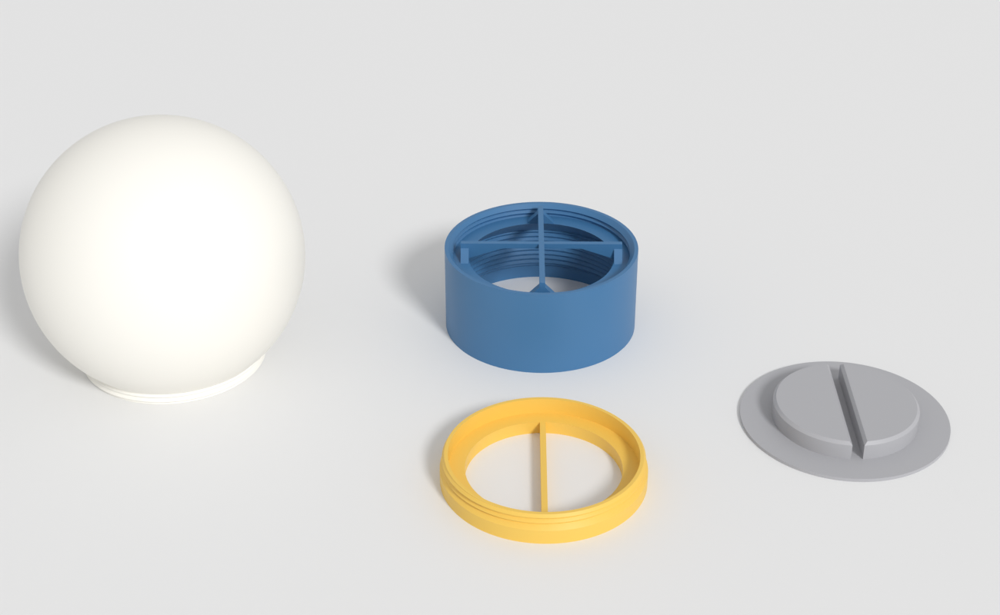
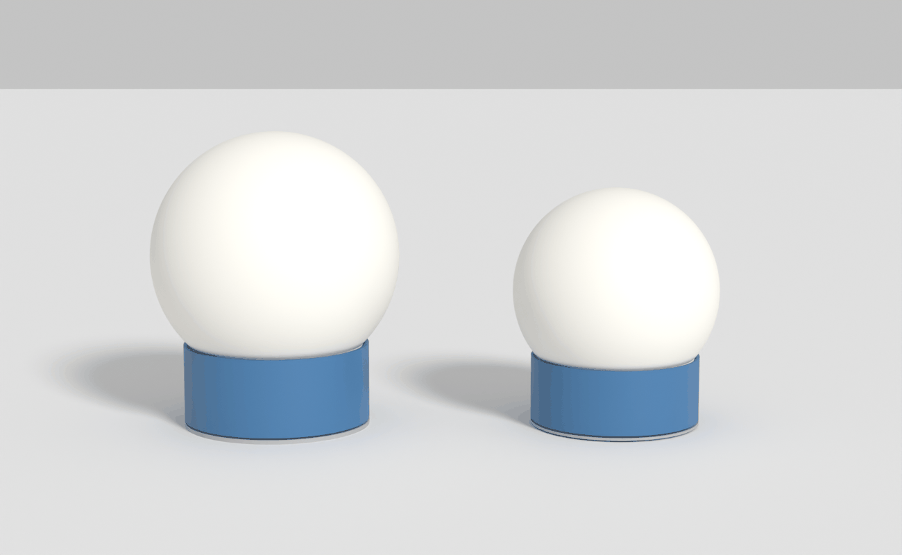
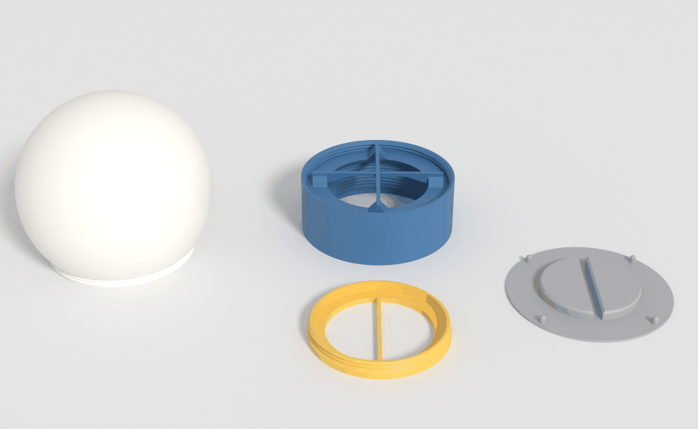
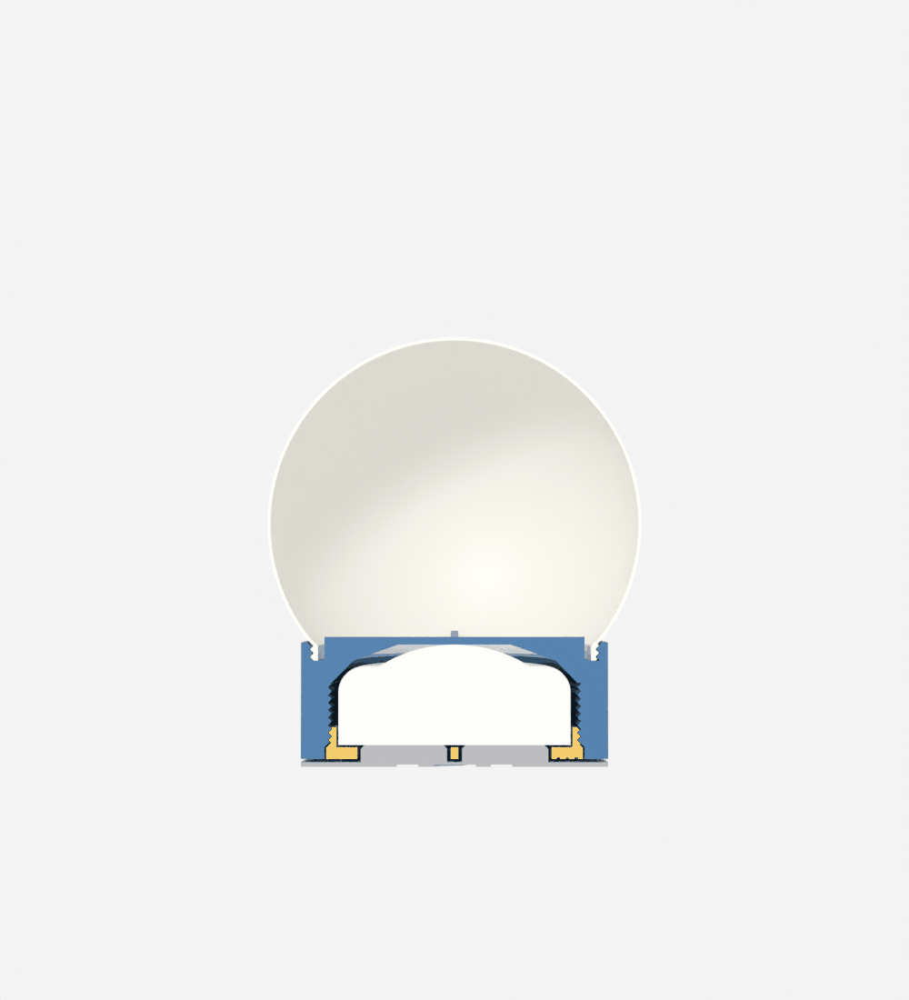
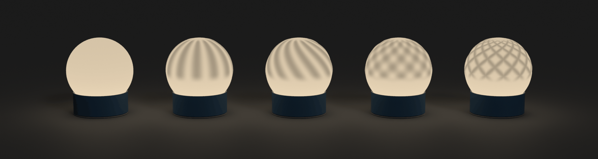
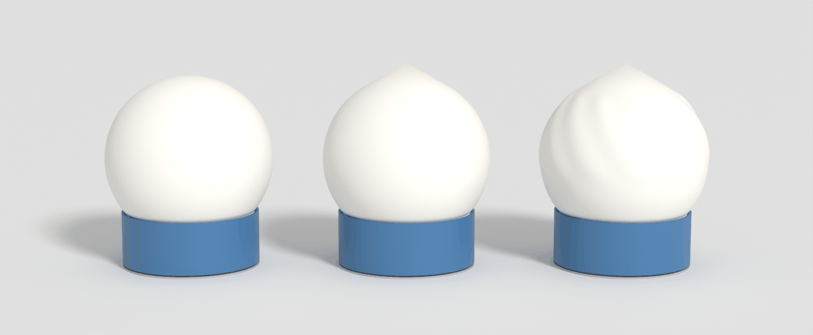
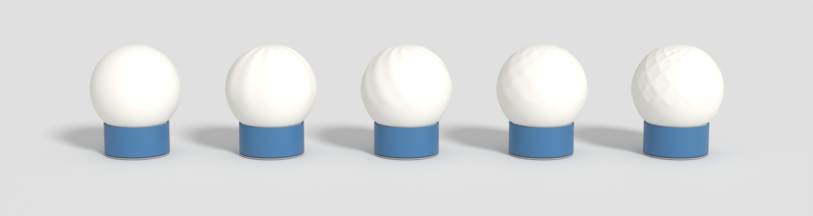

# Pucklight sphere

Sphere lamp for the 62 mm RGBW puck light. Prints in less than half the time of `RGBW_pucklight_lantern3`; spheres screw on and off, so you can print many and swap them.

Generators: `pucklight_sphereV2.scad` (newest), `pucklight_sphere.scad` (V1). Standalone, no libraries. Original description: `readme_hgc.md`.

## Fixes after the first print

In V1 and V2. Problems as reported in `v1_problems/readme_hgc.md`. The fix is not printed yet.

| Problem | Cause | Fix | Reprint |
|---|---|---|---|
| Screwin turned in all the way: the puck cannot move | 0.1 mm free play at the screw's stop (`puck_play` 0.7 less `seat_gap` 0.6), less than one layer | `puck_extra_play` 0.3: the screw's floor and bar lie 0.3 mm lower | screwin only: V1 18 min, V2 15 min (PETG, 0.28 mm) |

| Free play, measured on the geometry | Before | Now |
|---|---|---|
| Screwin flush | 0.7 mm | 1.0 mm |
| Screwin at its stop | 0.1 mm | 0.4 mm |

- Sockel and click base: geometry unchanged, no triangle differs. So is the click: on the click base the puck rests on the disc, not the floor.
- No contact: the puck on the floor, the bar in the slot, the screw flush.
- Still no room? Measure the puck. The generators use the CAD model's 26.8 mm, the spec sheet says 27.6 mm. At 27.6 mm the play would be 0.2 mm flush, and the puck would clamp before the stop. Then set `puck_height`.

## V2: smaller, thinner, faster

`pucklight_sphereV2.scad`. V1's parts do not fit: thread and pins differ. The click works as before.

| | V1 | V2 |
|---|---|---|
| Sphere | Ø120, 1.2 mm shell | Ø100, 0.8 mm shell |
| Pins | Ø5 × 5 | Ø3 × 4 |
| Sockel | Ø90 × 37 | Ø82 × 31; the ribs reach 32.5 inside the neck |
| Thread | Ø84, 3 turns, 2 mm wall | Ø77, 2 turns, 1.2 mm wall |
| Floor under the puck, bar | 5 mm | 3 mm |
| Screw's flange overhang | 1.5 mm | 0.5 mm |
| Click base's plate | 2 mm | 1.2 mm |
| Window over the puck | Ø50 | Ø54: more light, lower floor |
| Logo depth; sockel's logo | 1 mm; 10 mm wide | 0.6 mm; 5.9 mm wide |
| Lamp's height | 143 mm | 115 mm; with the vase mode sphere 122.5 mm |

### Print time

Slicer estimates, not printed yet: SnapmakerOrca, Snapmaker U1, no support, each part alone. Settings of `v1_snapmaker.3mf`: 0.28 mm layers, the sphere in SnapSpeed PLA (min layer time 4 s, max flow 20 mm³/s), the rest apparently in Generic PETG (12 s, 12 mm³/s).

| Part | V1 | V2 |
|---|---|---|
| Sphere, Arachne | 1 h 2 min, 58 g | 33 min, 25 g |
| Sockel | 1 h 12 min, 44 g | 54 min, 31 g |
| Click base | 30 min, 19 g | 21 min, 12 g |
| Screwin | 18 min, 9 g | 15 min, 7 g |
| **Whole lamp** | **3 h 1 min, 130 g** | **2 h 2 min, 75 g** |
| All in SnapSpeed PLA | 2 h 37 min | 1 h 46 min |

| Sphere, V2, SnapSpeed PLA | Normal, 0.28 mm | Vase mode, 0.2 mm |
|---|---|---|
| Plain | 33 min, 25 g | 31 min, 16 g (24 min at 3 s) |
| `waves` | 59 min, 33 g | 31 min, 16 g |
| `ribs`, `twist` | 1 h 11 min, 33 g | 31 min, 16 g |
| `lattice` | 1 h 20 min, 34 g | 32 min, 16 g |

What sets the time:

- Min layer time: a thin sphere hits it. PETG's 12 s makes V2's plain sphere 1 h 8 min against 33 min in SnapSpeed PLA. The same sphere at 0.2 mm has 430 layers × 8 s = 57 min, however thin the shell.
- Max flow: otherwise time follows the plastic.
- Sockel's infill: 8% instead of 15% saves 6 min.
- Formula spheres in normal mode are slow: walls that change width move slowly. More walls do not help.

Tried and left out, because they saved nothing:

| Idea | Result |
|---|---|
| Hollow sockel wall, 1.2 mm thick | 64.7 min against 61.3 solid: the extra wall loops cost more than the infill |
| Cut-outs in the click base's plate | 19.8 min against 19.6 |
| 3 to 5 walls on a formula sphere | 98 to 100 min: no gain |

### Slicer settings for V2's sphere

| Setting | Value | Why |
|---|---|---|
| Wall generator, walls | Arachne, 2 | 0.8 mm is two lines; classic takes 3 min longer |
| Filament | SnapSpeed PLA in white or a light colour | 4 s against PETG's 12 s |
| Brim | outer, 5 mm | the neck stands on a 1.2 mm ring; auto adds none |

### Vase mode sphere

`part = "vase_sphere"`. A solid: the slicer's vase mode prints its outline as one spiralling line, and the thread and the formulas are part of that outline. From the left: the normal sphere, the vase mode sphere, the vase mode sphere with `twist`.

| Slicer setting | Value | Why |
|---|---|---|
| Spiral vase | on | sets one wall, no top, no infill |
| **Bottom layers** | **0** | a floor closes the neck and hits the sockel's ribs: the sphere does not seat |
| Outer wall line width | 0.6 mm | a wider line overlaps the layer below more, see below |
| Layer height | 0.2 mm | at 0.28 mm the cone overlaps only 19%, see below |
| Min layer time | 3 to 4 s | at 0.2 mm in SnapSpeed PLA, 4 s: 31 min, 3 s: 24 min |
| Brim | outer, 5 mm | the first layer is one line; peel it off gently |

| Sliced with these settings | Result |
|---|---|
| Path | one line: no travel, no retraction before the top, z never falls |
| Bottom | open: nothing inside the neck on the first layer |
| Thread | outer edge at r = 38.50, the thread's major radius, so the fit stays as modelled |
| Formula | `twist`, `lattice` and `twist` at 3 mm depth also stay one line, and take no longer than plain |

A single wall cannot close a round top: it has no top layer and leans in only so far. So the sphere stays round up to `vase_overhang`, then ends in a straight cone to a point. Lower is safer, higher is rounder:

| `vase_overhang` | Tip above a round top | Overlap per layer, 0.6 mm line: 0.28 mm layers | 0.2 mm | 0.12 mm |
|---|---|---|---|---|
| 55° | 11.0 mm | 33% | 52% | 71% |
| **60°** | **7.7 mm** | 19% | **42%** | 65% |
| 65° | 5.2 mm | none | 29% | 57% |
| 70° | 3.2 mm | none | 8% | 45% |
| 75° | 1.8 mm | none | none | 25% |

- The wall is the same thickness everywhere, so a formula shows through its shape only. The contrast when lit should be weaker than on the normal sphere, where thickness changes. Hypothesis, not yet seen.
- No logo: the wall is one line, and the neck has no bottom.
- `shell` and `neck_wall` do not apply.
- Screw it in gently: the thread is a single line, about 0.6 mm thick.

### V2 checks

| Case | Result |
|---|---|
| Sphere seated, half a turn out, 2.5 turns out | no contact |
| Vase mode sphere seated, half a turn out; outside the ribs, since the solid fills the neck in the model | no contact |
| Sockel on the click base, pressed and released | no contact |
| Puck in the sockel and on the screwin; the bar in the disc's slot; screwin flush | no contact |
| Screwin `seat_gap` deeper | touches only on the stop cone, as designed |
| Meshes, `shell` 2, `sphere_d` 90 to 150, `vase_overhang` 45 to 75, `surface_depth` 5 | closed |
| `sphere_d` 80, `neck_d` 60 and 90, `sockel_d` 70 | stop with an error message |

### V2: not tested yet

- Nothing has been printed. Most open: the top of the 0.8 mm dome, the vase mode cone and its tip, the single-line thread, and the 3 mm pins, which are thin at 4 mm high.
- Test the thread first, as in V1: in the slicer, print only the sphere up to z = 10 and the sockel from z = 24.
- The lamp's 64 g rests on the puck's dome (54 g with the vase mode sphere), half of V1's. That makes a click by its own weight less likely.

## V1

`pucklight_sphere.scad`. Everything below describes V1.

## Parts

| Part | `part =` | Prints | Time | Weight |
|---|---|---|---|---|
| Sphere, plain | `sphere` | neck on the bed | 1 h 30 min | 59 g |
| Sockel | `sockel` | bottom on the bed | 1 h 17 min | 45 g |
| Screwin | `screwin` | bottom on the bed | 16 min | 9 g |
| Click base | `clickbase` | bottom on the bed | 30 min | 18 g |
| **Whole lamp** | | | **3 h 33 min** | **130 g** |

Slicer estimates, not printed yet: SnapmakerOrca, Snapmaker U1, the settings of `RGBW_pucklight_lantern3/printed.3mf` with 0.2 mm layers, no support.

Lamp on the click base: Ø120 mm, 143 mm high. Also: `assembly`, `section`, `print_layout`.

| Same settings | Lantern 3 V8 | Sphere lamp |
|---|---|---|
| Body | frame + roof: 5 h 59 min, 127 g | sphere + sockel: 2 h 47 min, 103 g |
| To try a new look | roof: 3 h 9 min | sphere: 1 h 30 min |

## Parameters

| Parameter | Default | Meaning |
|---|---|---|
| `sphere_d` | 120 | outer diameter; at least `neck_d` + 10 |
| `shell` | 1.2 | thickness, 0.8 to 2; thinner glows more |
| `surface` | `smooth` | formula for the outside, see below |
| `surface_depth` | 0.8 | height of the formula's peaks; the shell is `shell` + this thick there |
| `surface_count` | 12 | ribs, waves or spirals around the sphere |
| `surface_twist` | 120 | `twist`: degrees a rib turns from pole to pole |
| `sphere_columns` | 180 | mesh resolution; about 12 columns per rib |
| `neck_clearance` | 0.3 | radial gap of the sphere's thread |
| `front_logos` | false | true: also a logo you can see, see Logo |

## Surface formulas

The inside stays a smooth sphere, so a peak is thicker and darker when lit. The pattern is faint when off and strong when on.

Left to right, `lon` and `lat` in degrees, height from 0 to 1:

| `surface` | Formula | Print time | Weight |
|---|---|---|---|
| `smooth` | 0 | 1 h 30 min | 59 g |
| `ribs` | 0.5 + 0.5 cos(n lon) | 2 h 33 min | 73 g |
| `twist` | 0.5 + 0.5 cos(n (lon + twist lat / 180)) | 2 h 33 min | 73 g |
| `waves` | 0.5 + 0.5 cos(n lon) cos(n lat) | 2 h 4 min | 73 g |
| `lattice` | crossed loxodromes: max(0.5 + 0.5 cos(n lon ± m))³, m = n ln(tan(45° + lat / 2)) in degrees | 2 h 39 min | 73 g |

- Your own formula: add a line to `surface_height()` and its name to the `surface` list. Return 0 to 1.
- A formula fades in above the front logo's place, with or without the logo, and out towards the pole, so the neck and the closed top stay smooth.
- The lit picture assumes light falling off with distance and exp(-1.2 × thickness in mm). The real contrast depends on the filament.

## Slicer settings for the sphere

| Setting | Value | Why (measured in the slicer) |
|---|---|---|
| Wall generator | Arachne | classic fills the shell's middle with 140 m of gap infill; Arachne 19 mm, and it is faster |
| Walls | 3 | `surface_depth` 3 with 3 walls: 53 m of sparse infill in the shell, expected to show as dark spots. 6 walls: none (4 h 40 min, 110 g). 1.5 with 3 walls: none |
| Support | off | see below |
| Brim | auto | the neck stands on a 2 mm wide ring |
| Filament | white or translucent | |

## Printing without support

| Zone | Overhang | How it prints |
|---|---|---|
| Thread | 45° | flanks as in the holder |
| Neck to the sphere | 45° | cone |
| Lower half, outside | 43° at most | a larger sphere gets a longer cone, never more; with `front_logos`, the sphere logo's 0.6 mm deep edges reach 60° |
| Top, inside | up to 89° | closed walls lean in from 63° latitude; the slicer bridges the last Ø20 mm hole from 80° |

The top's outside stands on the layer below, so sagging stays inside. If the top sags too much: organic support inside, removed through the neck, or thinner layers.

## Thread and fit

| | |
|---|---|
| Thread | Ø84, 2 mm pitch, 45° flanks, right-handed, 3 turns |
| Male on | the sphere's neck |
| Female in | a cup on top of the sockel; it hides the thick neck, so all you see is thin shell |
| Stop | the neck's bottom on the cup's floor; no lining up needed |
| Clearance | 0.3 mm radial, as the lantern's roof |

Test the thread before a whole sphere, as `lessons_learned.md` advises for large parts: in the slicer, print only the sphere up to z = 12 and the sockel from z = 28.

Checked with boolean intersections of the exported parts:

| Case | Result |
|---|---|
| Sphere seated, half a turn out, 2.5 turns out | no contact |
| Sockel on the click base, pressed and released | no contact |
| Puck in the sockel and on the screwin; the bar in the disc's slot | no contact |
| Screwin flush | no contact |
| Screwin `seat_gap` deeper | touches only on the holder's stop cone, as designed |

Meshes: all parts closed. `shell` 0.8 and 2, `sphere_d` 94 to 200 and `surface_depth` up to 5 stay closed; `sphere_d` 90, `neck_d` 70 and 90 stop with an error message.

## Assembly

1. Put the puck into the sockel from below, dome first.
2. Screw in the screwin until it is flush, its bar midway between two pin holes.
3. Stand the sockel on the click base, the pins in their holes and the bar in the slot.
4. Screw the sphere in until it stops, about 3 turns.
5. Press the lamp down to click the light. Press near the sockel; the shell is thin.

## Differences from the lantern's holder

| | Lantern 3 | Here | Why |
|---|---|---|---|
| Body | square, 76 mm | round, Ø90 | asked for in `readme_hgc.md`; the pins need room without corners |
| Pins | in the corners, 43.2 mm from the axis | on the diagonals, 40.4 mm | so the lantern's click base does not fit |
| Click base | square | round, Ø90 | follows the body |
| Screwin, puck cavity, ribs, disc | | unchanged | copied from `RGBW_pucklight_holderV3.scad`; copy later changes by hand |

## Logo

In the bottoms only, hidden when the lamp stands on a desk. All 1 mm deep, reading from below.

| Part | Where | Width |
|---|---|---|
| Click base | bottom of the plate, on the desk | 40 mm |
| Sockel | bottom ring, between two pin holes | 10 mm |
| Screwin | bottom of the flange | 8 mm |
| Sphere | none: the neck's bottom is a 2 mm ring | |

- These print on the bed: the slicer bridges over each recess at z = 1.2, out of sight.
- `front_logos = true` adds a 20 mm logo (`front_logo_width`) in the sockel's front, 1 mm deep, and in the sphere's lower front, half through the shell, so it glows brighter.

## Render times (OpenSCAD 2021.01)

| Part | Time |
|---|---|
| Sphere | 1 s (3 s at 360 columns) |
| Sphere with `front_logos` | 20 s |
| Sockel | 30 s |
| `section` / `assembly` export | 2 / 3 min |

## Not tested yet

- Nothing has been printed: the thread's fit, the sphere's top and the click are open.
- The lamp's 112 g rests on the puck's dome (sockel, screwin, sphere), less than the lantern's. If that clicks the light by itself, stand it on something else.
- The checks above ran on the command line (OpenSCAD 2021.01); its window's preview was not opened. The pictures are from Blender.
- Another OpenSCAD build, apparently the browser playground: `export (81).stl` had the same four parts, sizes and volumes, before the logos moved to the bottoms.

## Not included

- Multicolor stained glass: left for later, as `readme_hgc.md` asks for a plain basic version. `lattice` comes closest in one colour.

Licensed under GPL.
