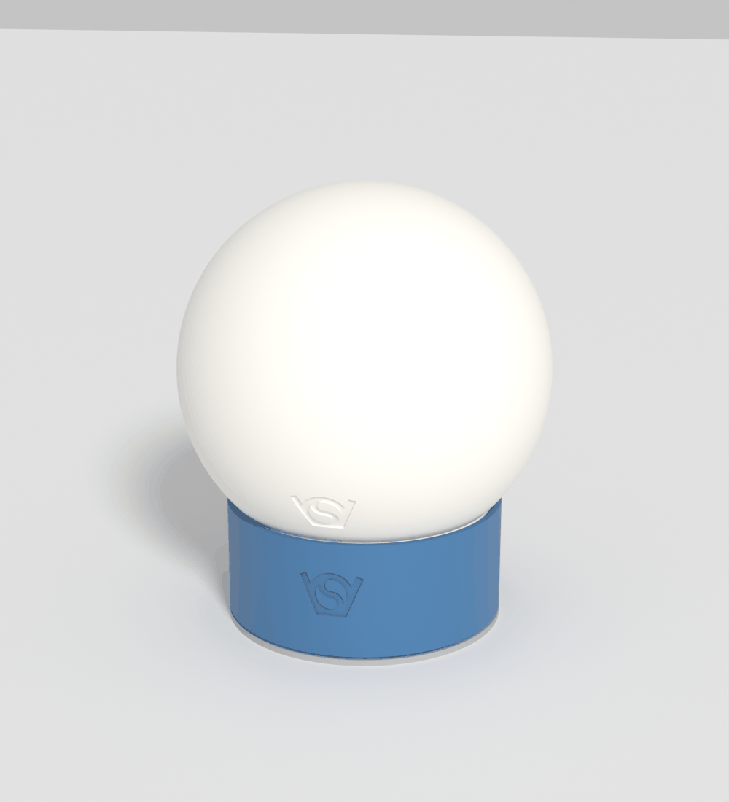
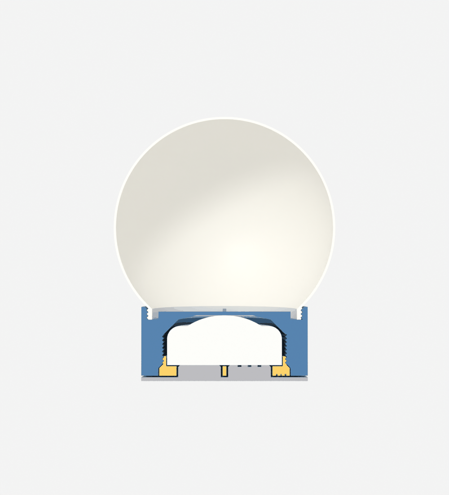
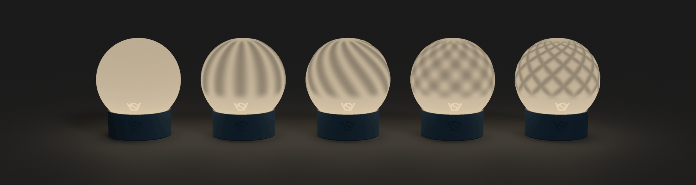

# Pucklight sphere

Sphere lamp for the 62 mm RGBW puck light. Prints in less than half the time of `RGBW_pucklight_lantern3`; spheres screw on and off, so you can print many and swap them.

Generator: `pucklight_sphere.scad`. Standalone, no libraries. Original description: `readme_hgc.md`.

## Parts

| Part | `part =` | Prints | Time | Weight |
|---|---|---|---|---|
| Sphere, plain | `sphere` | neck on the bed | 1 h 30 min | 59 g |
| Sockel | `sockel` | bottom on the bed | 1 h 17 min | 45 g |
| Screwin | `screwin` | bottom on the bed | 16 min | 9 g |
| Click base | `clickbase` | bottom on the bed | 29 min | 18 g |
| **Whole lamp** | | | **3 h 32 min** | **130 g** |

Slicer estimates, not printed yet: SnapmakerOrca, Snapmaker U1, the settings of `RGBW_pucklight_lantern3/printed.3mf` with 0.2 mm layers, no support.

Lamp on the click base: Ø120 mm, 143 mm high. Also: `assembly`, `section`, `print_layout`.

| Same settings | Lantern 3 V8 | Sphere lamp |
|---|---|---|
| Body | frame + roof: 5 h 59 min, 127 g | sphere + sockel: 2 h 46 min, 103 g |
| To try a new look | roof: 3 h 9 min | sphere: 1 h 30 min |

## Parameters

| Parameter | Default | Meaning |
|---|---|---|
| `sphere_d` | 120 | outer diameter; at least `neck_d` + 10 |
| `shell` | 1.2 | thickness, 0.8 to 2; thinner glows more |
| `surface` | `smooth` | formula for the outside, see below |
| `surface_depth` | 0.8 | height of the formula's peaks; the shell is `shell` + this thick there |
| `surface_count` | 12 | ribs, waves or spirals around the sphere |
| `surface_twist` | 120 | `twist`: degrees a rib turns from pole to pole |
| `sphere_columns` | 180 | mesh resolution; about 12 columns per rib |
| `neck_clearance` | 0.3 | radial gap of the sphere's thread |
| `sphere_logo` | true | false: mesh only, renders in 1 s instead of 20 s |

## Surface formulas

The inside stays a smooth sphere, so a peak is thicker and darker when lit. The pattern is faint when off and strong when on.

Left to right, `lon` and `lat` in degrees, height from 0 to 1:

| `surface` | Formula | Print time | Weight |
|---|---|---|---|
| `smooth` | 0 | 1 h 30 min | 59 g |
| `ribs` | 0.5 + 0.5 cos(n lon) | 2 h 32 min | 73 g |
| `twist` | 0.5 + 0.5 cos(n (lon + twist lat / 180)) | 2 h 34 min | 73 g |
| `waves` | 0.5 + 0.5 cos(n lon) cos(n lat) | 2 h 1 min | 73 g |
| `lattice` | crossed loxodromes: max(0.5 + 0.5 cos(n lon ± m))³, m = n ln(tan(45° + lat / 2)) in degrees | 2 h 40 min | 73 g |

- Your own formula: add a line to `surface_height()` and its name to the `surface` list. Return 0 to 1.
- A formula fades out above the logo and towards the pole, so the neck, the logo and the closed top stay smooth.
- The lit picture assumes light falling off with distance and exp(-1.2 × thickness in mm). The real contrast depends on the filament.

## Slicer settings for the sphere

| Setting | Value | Why (measured in the slicer) |
|---|---|---|
| Wall generator | Arachne | classic fills the shell's middle with 140 m of gap infill; Arachne 19 mm, and it is faster |
| Walls | 3 | `surface_depth` 3 with 3 walls: 53 m of sparse infill in the shell, expected to show as dark spots. 6 walls: none (4 h 40 min, 110 g). 1.5 with 3 walls: none |
| Support | off | see below |
| Brim | auto | the neck stands on a 2 mm wide ring |
| Filament | white or translucent | |

## Printing without support

| Zone | Overhang | How it prints |
|---|---|---|
| Thread | 45° | flanks as in the holder |
| Neck to the sphere | 45° | cone |
| Lower half, outside | 43° at most | a larger sphere gets a longer cone, never more; the logo's 0.6 mm deep edges reach 60° |
| Top, inside | up to 89° | closed walls lean in from 63° latitude; the slicer bridges the last Ø20 mm hole from 80° |

The top's outside stands on the layer below, so sagging stays inside. If the top sags too much: organic support inside, removed through the neck, or thinner layers.

## Thread and fit

| | |
|---|---|
| Thread | Ø84, 2 mm pitch, 45° flanks, right-handed, 3 turns |
| Male on | the sphere's neck |
| Female in | a cup on top of the sockel; it hides the thick neck, so all you see is thin shell |
| Stop | the neck's bottom on the cup's floor; no lining up needed |
| Clearance | 0.3 mm radial, as the lantern's roof |

Test the thread before a whole sphere, as `lessons_learned.md` advises for large parts: in the slicer, print only the sphere up to z = 12 and the sockel from z = 28.

Checked with boolean intersections of the exported parts:

| Case | Result |
|---|---|
| Sphere seated, half a turn out, 2.5 turns out | no contact |
| Sockel on the click base, pressed and released | no contact |
| Puck in the sockel and on the screwin; the bar in the disc's slot | no contact |
| Screwin flush | no contact |
| Screwin `seat_gap` deeper | touches only on the holder's stop cone, as designed |

Meshes: all parts closed. `shell` 0.8 and 2, `sphere_d` 94 to 200 and `surface_depth` up to 5 stay closed; `sphere_d` 90, `neck_d` 70 and 90 stop with an error message.

## Assembly

1. Put the puck into the sockel from below, dome first.
2. Screw in the screwin until it is flush, its bar midway between two pin holes.
3. Stand the sockel on the click base, the pins in their holes and the bar in the slot.
4. Screw the sphere in until it stops, about 3 turns.
5. Press the lamp down to click the light. Press near the sockel; the shell is thin.

## Differences from the lantern's holder

| | Lantern 3 | Here | Why |
|---|---|---|---|
| Body | square, 76 mm | round, Ø90 | asked for in `readme_hgc.md`; the pins need room without corners |
| Pins | in the corners, 43.2 mm from the axis | on the diagonals, 40.4 mm | so the lantern's click base does not fit |
| Click base | square | round, Ø90 | follows the body |
| Screwin, puck cavity, ribs, disc | | unchanged | copied from `RGBW_pucklight_holderV3.scad`; copy later changes by hand |

## Logo

| Part | Where |
|---|---|
| Sphere | lower front, 20 mm wide, half through the shell, so it glows brighter |
| Sockel | front, 20 mm wide, 1 mm deep |
| Screwin | bottom of the flange, 8 mm wide |
| Click base | top of the disc, 18 mm wide |

## Render times (OpenSCAD 2021.01)

| Part | Time |
|---|---|
| Sphere without logo | 1 s (3 s at 360 columns) |
| Sphere with logo | 20 s |
| Sockel | 24 s |
| `section` / `assembly` export | 2 / 3 min |

## Not tested yet

- Nothing has been printed: the thread's fit, the sphere's top and the click are open.
- The lamp's 112 g rests on the puck's dome (sockel, screwin, sphere), less than the lantern's. If that clicks the light by itself, stand it on something else.
- The checks above ran on the command line (OpenSCAD 2021.01); its window's preview was not opened. The pictures are from Blender.
- Another OpenSCAD build, apparently the browser playground: `export (81).stl` has the same four parts, sizes and volumes.

## Not included

- Multicolor stained glass: left for later, as `readme_hgc.md` asks for a plain basic version. `lattice` comes closest in one colour.

Licensed under GPL.
