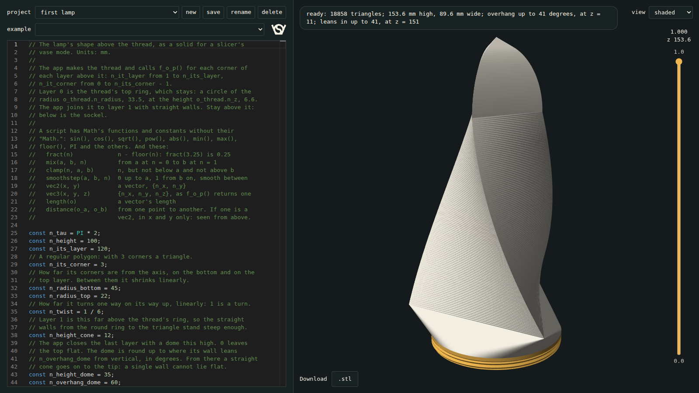
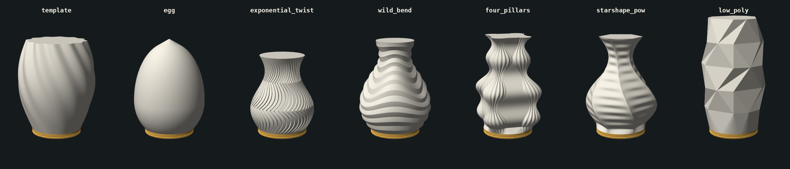
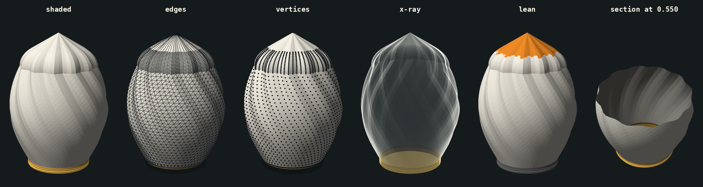

# Pucklight vase

Webapp: a script in an editor places the corners of each layer, and the app puts them on the thread of the pucklight sphere, so the vase screws into the same sockel. Keeps its scripts in named projects. Downloads `.stl`, a solid for a slicer's vase mode. Original description: `readme_hgc.md`.

| Start | |
|---|---|
| `deno task start` in this folder, then http://localhost:8766 | everything; reachable from this computer only |
| Open `index.html` in a browser | no Deno needed, no projects, the rest works |

The editor comes from the internet; without it a plain text box replaces it.

| File | What |
|---|---|
| `index.html` | layout |
| `app.js` | editor, 3D view, projects, download |
| `vase_mesh.js` | the thread, the collar and a script's layers as one mesh; the functions a script sees; `.stl` |
| `noise.js` | `noise` for the scripts: stlsculpter's `perlin2.js`, Stefan Gustavson's simplex and Perlin noise, public domain by its header |
| `examples.js` | the scripts the editor offers |
| `server.js` | serves the app and keeps the projects |
| `deno.json` | the `start` task |
| `projects/` | the projects, for git to track: `<name>/script.js` |
| `test_vase_mesh.js` | `node test_vase_mesh.js`; needs `openscad` |
| `stlsculpter/` | inspiration, not in git: a clone of github.com/jonasfrey/stlsculpter |

## The lamp

| Part | From |
|---|---|
| Vase | this app |
| Sockel, screwin, click base | `../pucklight_sphere/pucklight_sphereV3.scad`, `part = "sockel"`, `"screwin"`, `"clickbase"` |

A vase and V3's spheres fit the same sockel.

## Projects

| | Control | On disk |
|---|---|---|
| Create | new: a copy of what is in the editor, under a new name | `projects/<name>/script.js` |
| Read | the project list; the address `#<name>` opens it again after a reload | |
| Update | save, or Ctrl+S, in the editor too; a `*` in the list means unsaved | `script.js` |
| Update | rename | the folder moves |
| Delete | delete, asks first | the folder goes |

- A project holds its script, as it is in the editor. Other files in its folder, such as a `.3mf`, stay.
- example puts an example's script into the editor: in a project that is a change to it, to save, or to keep as a new project with new.
- Without a project, save asks for a name.
- A name has letters, digits, spaces, `_` and `-`, and is the folder's name.
- Opening another project or example, or closing the page, with unsaved changes asks first.
- API: `GET /api/projects`, and `GET`, `POST`, `PUT`, `PATCH`, `DELETE /api/projects/<name>`, the script as `{"code": ...}`.
- The server writes to `projects/` only, listens on localhost only, and refuses requests from other web pages.

## Script

The editor holds the body of a function: it gets `o_thread`, sees `noise` and the functions below, and returns `{n_its_layer, n_its_corner, f_o_p}`, with `n_height_dome` for a dome on top.

| Name | Is |
|---|---|
| `n_its_layer` | layers above the thread, from 1 |
| `n_its_corner` | corners of each layer, from 3 |
| `f_o_p(n_it_layer_nor, n_it_corner_nor, n_it_layer, n_it_corner)` | the callback, called for each corner of each layer; returns `{n_x, n_y, n_z}` in mm |
| `n_it_layer`, `n_it_layer_nor` | 1 to `n_its_layer`, and that divided by `n_its_layer`: 1 on the top layer |
| `n_it_corner`, `n_it_corner_nor` | 0 to `n_its_corner - 1`, and that divided by `n_its_corner` |
| `o_thread.n_radius`, `o_thread.n_z` | 33.5 and 6.6: the top ring of what is fixed, as it were layer 0 |
| `n_height_dome` | optional: the app closes the last layer with a dome this high, in mm; 0 or left out, with a flat face |
| `n_overhang_dome` | optional, 60: how far the dome's wall may lean from vertical, in degrees, above 0 and below 90 |
| `noise.simplex2(x, y)`, `noise.simplex3(x, y, z)` | simplex noise: a number from -1 to 1, which changes smoothly from place to place, about one bump per 1 |
| `noise.perlin2(x, y)`, `noise.perlin3(x, y, z)` | Perlin noise: the same on a grid of squares; 0 where x, y and z are whole numbers |
| `noise.seed(n)` | another pattern: a whole number from 1 to 65535, or, as in stlsculpter, between 0 and 1 |

| Function | Is |
|---|---|
| `sin()`, `cos()`, `sqrt()`, `pow()`, `abs()`, `min()`, `max()`, `floor()`, `PI` and the others | `Math`'s functions and constants, without their `Math.` |
| `fract(n)` | `n - floor(n)`: `fract(3.25)` is 0.25 |
| `mix(a, b, n)` | from `a` at `n` = 0 to `b` at `n` = 1 |
| `clamp(n, low, high)` | `n`, but not below `low` and not above `high` |
| `smoothstep(low, high, n)` | 0 up to `low`, 1 from `high` on, smooth between |
| `vec2(x, y)`, `vec3(x, y, z)` | a vector: `{n_x, n_y}`, and `{n_x, n_y, n_z}`, as `f_o_p()` returns one |
| `length(o)` | a vector's length |
| `distance(o_a, o_b)` | from one point to another; if one is a `vec2`, in x and y only, as seen from above |

- A script's own `sin` or `fract` takes the place of these: scripts from before keep working. `Math.sin()` works as before.
- The editor offers them and shows their arguments. It no longer offers the browser's own names, such as `document`; `console.log()` it knows.

| Noise | Minimal example, in `f_o_p()` |
|---|---|
| The layers in and out, by up to 3 mm | `n_amp += noise.simplex2(0.5, n_it_layer_nor * 4) * 3;` |
| Narrower, deeper | multiply what goes in, what comes out |
| Each corner of a polygon on its own | `n_amp += noise.simplex2(n_it_corner_nor * n_its_corner, n_it_layer_nor * 3) * 4;` |
| A twist that wobbles | `n_rad_offset += noise.simplex2(0.5, n_it_layer_nor * 2) * n_tau / 30;` |
| Bumps around the ring without a seam: x and y on a circle | `n_amp += noise.simplex3(sin(n_it_corner_nor * n_tau) * 2, cos(n_it_corner_nor * n_tau) * 2, n_it_layer_nor * 4) * 3;` |
| Another pattern | `noise.seed(7);` above `f_o_p()` |

- The last four are in `template`'s comments, to try without their `//`.
- `n_it_corner_nor` alone as x or y leaves a seam where the ring closes: the noise at 0 is not the noise at 1.
- A script starts on seed 0, whatever the script before it seeded: the same script makes the same vase, in the view and in the `.stl`.
- z = 0 is the print bed. Every `n_z` must be `o_thread.n_z` or more: below is the sockel.
- The app joins the top ring to layer 1 with straight walls. Start on the ring, as `egg`, or higher, which makes a cone, as `template` and `four_pillars`.
- The two may differ in their number of points: 180 on the ring, 12 in `low_poly`.
- Corners may run either way around the axis and start anywhere; all layers the same way.
- At most 2 000 000 points.
- The last layer is closed with a flat face, which vase mode leaves open, or with a dome.
- Dome: the last layer shrinks towards its centre along an ellipse, so its pattern runs on to the tip. A single wall cannot lie flat: where it leans `n_overhang_dome`, the dome goes on as a straight cone. Lower is safer and more pointed.
- The dome starts upright: a shape that ends upright joins it without a crease.
- A dome lower than its cone alone, the last layer's widest radius / tan(`n_overhang_dome`), is that cone, and steeper than asked: the status shows it.
- `egg` closes by its own formula instead, so a pattern can change all the way up.
- A mistake shows in the status and, with its line, in the editor; the last good vase stays.
- A new example: add an entry to `examples.js`.

## What is fixed

Gold in the view. `f_o_p()` is not called for it.

| Part | z | Is |
|---|---|---|
| Thread | 0 to 4.8 | V3's `vase_sphere`: Ø67, 2 mm pitch, 45° flanks, 180 columns, a row every 0.1 mm |
| Collar | 4.8 to 6.6 | cylinder Ø67; the ribs in the sockel's cup end at 6.19, so a script cannot reach them |

## View

| Control | Does |
|---|---|
| drag, wheel | orbit, zoom |
| view: `shaded` | the mesh as it is exported, one normal per triangle; what is fixed in gold |
| view: `edges` | the triangles' edges on it |
| view: `vertices` | the points on it |
| view: `x-ray` | shows through: outlines, also of the back and the inside |
| view: `overhang` | the script's walls that lean over 45° from vertical, with a legend: an overhang, which leans out and faces down, in orange, over 60° in red; a wall that leans in, in light blue, over 60° in blue; what is fixed in grey |
| slider | section: hides what is above its height, from 0.0, the bed, to 1.0, the top; above it the number, and z in mm |

- The section works in every view. The inside is darker.
- `overhang`: a single wall has as little under it leaning in as leaning out, so both show. Overhangs show from below, walls that lean in from above, both on the inside through a section.
- `overhang` has half a degree to spare, so a dome made for 60° stays light blue. A flat top is blue: vase mode leaves it open.
- The status has both in numbers: the steepest overhang and the steepest wall that leans in, with their heights.
- A fine mesh is black with edges or vertices from afar: zoom in.

## Examples

`template` explains the script, with examples of noise in its comments. `egg` is a preset to put a pattern on. The others are stlsculpter's, with their formulas and names: the radius starts on the thread's 33.5 instead of `n_radius_base`, or on a cone, and z on `o_thread.n_z`.

| Example | stlsculpter's | Layers × corners | Triangles | High × wide | Overhang up to | Leans in up to |
|---|---|---|---|---|---|---|
| `template` | `template.js`, changed: a triangle that turns a sixth of a turn and shrinks linearly, with a dome | 120 × 3 | 18858 | 153.6 × 89.6 | 41° at z = 11: its cone | 41° at z = 151: its dome |
| `egg` | none | 160 × 180 | 75600 | 128.3 × 96.0 | 43° at z = 7 | 60° at z = 124: its cone |
| `exponential_twist` | `vase_exponential_twist.js` | 100 × 400 | 98000 | 106.6 × 87.0 | 47° at z = 39 | 51° at z = 39 |
| `wild_bend` | `vase_wild_bend.js` | 120 × 300 | 90000 | 126.6 × 97.5 | 49° at z = 7 | 49° at z = 81 |
| `four_pillars` | `vase_four_pillars.js` | 120 × 500 | 138000 | 132.6 × 98.6 | 52° at z = 14 | 52° at z = 73 |
| `starshape_pow` | `template_starshape_pow_function.js` | 240 × 600 | 306000 | 131.6 × 100.5 | 52° at z = 16 | 52° at z = 72 |
| `low_poly` | `vase_long_low_poly_multi_layer.js` | 5 × 12 | 18120 | 156.6 × 86.2 | 24° at z = 57 | 26° at z = 137 |
| `low_poly_noise` | `vase_low_poly_noise` in `client.module.js`, with the layers, 10 mm apart, and the 12 corners of its `low_poly_vase` | 15 × 12 | 18360 | 156.6 × 100.0 | 43° at z = 10 | 38° at z = 80 |

- Of each example's triangles 17820 are the thread's and the collar's. Between its layers `low_poly` has 96, `low_poly_noise` 336.
- `low_poly_noise`: noise moves each corner along its ring by up to half a corner. `noise.seed()` with another number makes another vase.
- `template`: `n_its_corner` is the polygon, `n_radius_bottom` and `n_radius_top` its size, `n_twist` its turn. `n_height_dome = 0` leaves its top flat.
- `template`: each side of a layer is two triangles, which the twist bends against each other by up to 0.2 mm: fine stripes in `shaded`. More layers make them finer.

## Printing

Vase mode, as V3's `vase_sphere`: see `../pucklight_sphere/readme.md`, Vase mode.

| Slicer setting | Value | Why |
|---|---|---|
| Spiral vase | on | one wall, no top, no infill |
| **Bottom layers** | **0** | a floor closes the neck: no light, and it hits the sockel's ribs |
| Outer wall line width | 0.6 mm | overlaps the layer below more |
| Layer height | 0.2 mm | |
| Brim | outer, 5 mm | the first layer is one line |

- The status has how far the script's walls lean from vertical at most, out, as an overhang, and in. 45° is safe. The `overhang` view shows where.
- A dome and `egg` close at 60°, as V3's `vase_sphere` at its `vase_overhang`; `n_overhang_dome` and `egg`'s `n_overhang` change it.
- Beyond 45°, from V3's table, overlap per layer of a 0.6 mm line at 0.2 mm layers: 52% at 55°, 42% at 60°, 29% at 65°, 8% at 70°.
- Screw it in gently: the thread is a single line.
- Hypothesis, not tried: 2 walls, 0 top and bottom layers and 0% infill instead of vase mode give a sturdier thread.

## Logo

| Part | Logo |
|---|---|
| Vase | none: one wall, and the neck has no bottom |
| Click base, screwin | V3's, in their bottoms |
| App | in its header |

## Checks

| Check | Result |
|---|---|
| `test_vase_mesh.js`: the thread against OpenSCAD's `vase_sphere` of V3 | 8821 points within 0.0001 mm, 17460 faces the same way |
| Same: the collar against V3's `rib_top - top_z` | ends 0.41 mm above the ribs |
| Same: every example | closed, the thread not moved, nothing below 6.6 |
| Same: 3 to 500 corners, clockwise and counter-clockwise, starting anywhere | closed, the same volume |
| Same: domes 20 to 300 high, at 45°, 60° and 89°, both ways around, and on a star with a wavy last layer | closed, no face without area, the tip at its height, as steep as asked; lower than its cone, that cone |
| Same: scripts that return nothing, no numbers, a point below the thread, too many points, a dome below 0 or at 90° | refused with a message |
| `template`, `low_poly` and `low_poly_noise` `.stl` in V3's sockel, intersections in OpenSCAD 2021.01; a wall as thick as V3's neck stands in for the single wall | seated: only the bottom on the cup's floor, the stop. 0.01 mm higher, half a turn out, 2.5 turns out: no contact |
| Same, pushed 0.5 mm down, and turned half a turn without rising | contact, so the check finds one |
| App in headless Chrome 154: typing, mistakes, examples, the question before discarding a changed script, orbit, zoom, download | works, console clean; the `.stl` has the bytes Node makes |
| Without the internet | the text box replaces the editor, the rest works |
| Projects in headless Chrome: create from an example, save, new, switch with and without unsaved changes, rename, reload on `#<name>`, download, delete down to none | works, console clean; `script.js` holds the editor's text each time |
| Names the server refuses, from the app: taken, `../x`, `a/b`, `.git`, a space | the status says why, nothing touched |
| API with `../..`, `a/b`, `.git`, no script, another site's `Origin` and `Host` | refused, nothing touched |
| `test_vase_mesh.js`: the functions a script sees | `Math`'s without `Math.`; `fract`, `mix`, `clamp`, `smoothstep`, `length` and `distance` give what the table says, `distance` with a `vec2` either way round; a script's own `sin`, `fract`, `length` and `distance` take their place; `template` with `Math`'s own is the same vase |
| Functions in headless Chrome 154: `template`, every example, and a script from before with its own `fract`, `sin` and `cos` | drawn, nothing marked; typing `smo`, `fra`, `dis`, `len` offers them first; each explained with its arguments |
| A mistake's line with the functions, also on line 1 and in a script with its own `sin` | found in Chrome 154 and Firefox 157 |
| Ctrl+S in headless Chrome 154: in the editor after typing, outside it, with caps lock, without a project, opened as a file | saves what the editor holds, also before the view has caught up; without a project asks for a name; as a file nothing; the browser's own save never comes |
| Opened as a file | project controls off, the rest works |
| Views in headless Chrome: each view, the section in each, the slider by mouse and by value | drawn as above; the slider's top is 1.0 |
| `overhang` on a `wild_bend` half as high, from above, from below and through a section | overhangs orange and red from below and on the inside, walls that lean in blue from above, the legend only in this view |
| `test_vase_mesh.js`: a wall that goes out 6.5 in 3 mm, with and without a dome | an overhang of 65°, both ways around; the dome leans in only |
| A mistake's line | found in Chrome 154 and Firefox 157 |
| `test_vase_mesh.js`: `noise`'s four functions, and a script with and without `noise.seed()` | from -1 to 1, Perlin's 0 on whole numbers; a script makes the same vase each run, whatever the script before it seeded, and another with a seed |
| Same: `template`'s three examples of noise without their `//`, each with and without `noise.seed(7)` above `f_o_p()` | closed, each another vase |
| Noise in headless Chrome 154: the examples typed into the editor, `noise.` typed, `noise.simplex4()` typed, `low_poly_noise` downloaded | drawn; the editor offers the five functions; a mistake with its line; the `.stl` has the bytes Node makes; console clean |

## Not tested yet

- Not sliced, not printed. Most open: the thread as a single wall in V3's cup, the examples' walls of up to 52°, and the tips of the dome and the egg.
- Only on software WebGL in Chrome: no real GPU. Firefox: only the mistake's line.

## Not included

- stlsculpter's other vases with noise, such as `vase_noise_elegant_lines.js`: `noise` is here, the vases are not put on the thread yet.
- A normal mode vase with a thick neck, as V3's `sphere`: the inside would need its own surface.

Licensed under GPL.
