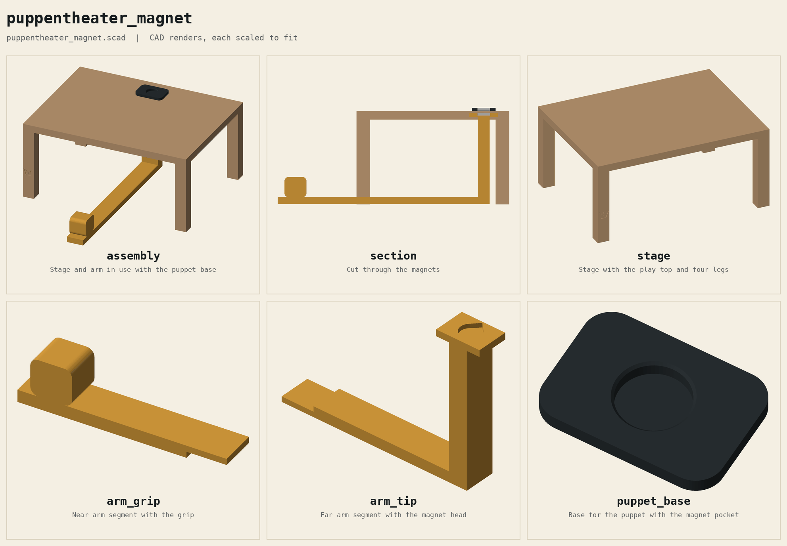

# Puppentheater mit Magneten / magnetic puppet theatre

A tabletop stage for print-in-place articulated models. The play top is 2 mm
thin; an arm slides under it with a Ø15 magnet in its head, and the puppet
stands on a base with the matching magnet. Moving the arm drags the puppet
over the stage, with the hand hidden below the top, as in the toy theatres of
the last century (see [research.md](research.md)).

The idea comes from [image.png](image.png) and
[readme_hgc.md](readme_hgc.md).

## How it works

| at | z | part |
|---|---|---|
| pad's face | 108.0 | pressed against the stage's underside by the magnet |
| arm's magnet face | 107.8 | 0.2 behind the pad's face |
| play face | 110.0 | stage top, 2.0 thick |
| puppet's magnet face | 110.6 | 0.6 above the play face |
| gap | 2.84 | between the two magnet faces |

The arm lies on the desk with its grip in front of the stage. Its head rises
94.6 mm to a 34 × 24 pad; the magnet pulls the pad up against the stage's
underside, so the gap stays at 2.8 mm while the arm slides. The puppet's base
is 4 mm thick: a 0.6 floor, the magnet, and a 0.4 glue recess. The stage's rim
stiffens the thin top and leaves the middle open.

## Parts

| part | size | what | prints |
|---|---|---|---|
| `stage` | 240 × 180 × 110 | top 2.0, rim 4 × 8 under the edge, four 16 × 16 legs | one piece |
| `arm_grip` | 130 × 24 × 32 | near segment with the thumb knob | one |
| `arm_tip` | 155 × 24 × 108 | far segment with the riser and the magnet head | one |
| `puppet_base` | 40 × 28 × 4 | magnet pocket and glue face for the puppet | one |

Assembled the arm is 260 long: the two segments lap 25 mm, the tip's lower
4 mm under the grip's upper 4 mm. The step at each end of the lap stops them
sliding in X, and both are 24 wide, so the outer faces align on a flat desk.

## Print

| part | orientation | supports |
|---|---|---|
| `stage` | flipped, play face on the bed | none |
| `arm_grip`, `arm_tip` | laid on the side, the 24 mm width up | none |
| `puppet_base` | as modelled, the pocket up | none |

0.2 mm layers, 3 walls, 15 % infill. The play face is the bed face: print it on
a smooth plate, because the puppet slides on it (a rough top costs the grip).
The arm's magnet pocket is a horizontal hole when the arm is on its side, so
it has a 45° teardrop roof; its peak leaves 1.1 mm of the pad's 24 width.

The stage is 240 × 180 as large as a 256 bed allows; one piece only, because a
seam in the play face would break the magnet's path. The arm prints in two
parts to fit a 180 bed as well (each 155 × 108 and 130 × 32).

## Assembly

| step | |
|---|---|
| 1 | Glue the arm's lap on a flat surface, outer faces flush. Let it cure. |
| 2 | Glue the puppet's magnet into the base's pocket, face down. Hold the arm's magnet under it to find the face that attracts, then glue that magnet into the pad the same way. Check the polarity of the pair before the glue sets. |
| 3 | Glue the puppet on the base's top: for the test, a piece of the chain from [`basic_fdm_printable_articulation_link`](../01_published_or_archived/basic_fdm_printable_articulation_link/) (print-in-place links); for another model, its belly on the 40 × 28 face. |
| 4 | Slide the arm's head under the stage; the magnet finds the base and pulls the pad up. |

The base is the universal adapter: it is only 4 mm thick and can be glued under
any model. A model with a flat belly and no overhang near the magnet can also
get the pocket directly, but it must then be printed with the pocket up; the
base avoids that.

## Magnets

| value | |
|---|---|
| default | Ø15 × 3, N42 or stronger, one pair |
| pockets | Ø15.4 (diameter clearance 0.4) |
| faces apart | 2.8 mm at the working gap |
| pull at that gap | ~1.9 N by the pole model (Br 1.32 T), expect 20–30 % less |
| sideways at that gap | peaks at ~0.8 N 2 mm off centre, by the same model |
| friction limit | the puppet's slide is μ × (weight + pull); at μ 0.3 and 40 g the pull barely wins, at μ 0.25 it does |

A thinner stage or a bigger magnet helps; the magnet's size is limited by the
pad and the base, and the asserts name the parameter to raise. The arm's pad
and base fit Ø15 as they are. N52 gains about 20 %.

One magnet pair cannot steer the facing: a disc's field turns freely about its
axis, so the puppet can spin about the magnet. The 1953 patent
([US2637138](https://patents.google.com/patent/US2637138A/en)) puts a bar
magnet in the doll's base, which does steer. Two magnet pairs side by side in
the pad and the base would steer the puppet too; with Ø12 each the pull stays
about that of one Ø15, with Ø15 each it doubles but the pad's X has to grow
from 34 to 42 and the base's from 40 to 44. Not built yet.

## Use

Set the stage on a desk. Hold the grip with the thumb and index and slide the
arm's head under the play face; it sticks to the underside, so the hand only
walks it. The head reaches 260 mm from the grip's end: the whole 180 depth from
one side, and 240 width with a step around the stage. The 34 × 24 pad cannot
go under the 4 mm rim, so the outer 16 mm across the arm and 21 mm along it
are out of reach; the play area is 208 × 138 inside the stage's 240 × 180.

## Files

| file | |
|---|---|
| `puppentheater_magnet.scad` | the stage, the two arm segments and the base; `part` selects one, `assembly` and `section` show the working gap |
| `rendered_parts/` | the parts under their names, and `overview.png` |
| `research.md` | what exists, what is new, what the sources say about the design |
| `research/` | the user's finds, including the finger-puppet play |
| `image.png`, `readme_hgc.md` | the sketch and the original description |

The logo is engraved 0.8 deep on the outer face of the stage's front left leg.
The arm segments and the base have no face large enough for it.

## Status

Designed and rendered, **not printed** (2026-11-21). The first print should
answer: does a 40 g chain follow at 2.8 mm, and does it follow on a smooth
plate? If it slips, try `stage_t = 1.6` or a N52 magnet before changing the
geometry.

## License

Copyright (C) Jonas Immanuel Frey — GPL, see [`LICENSE`](../../LICENSE).
