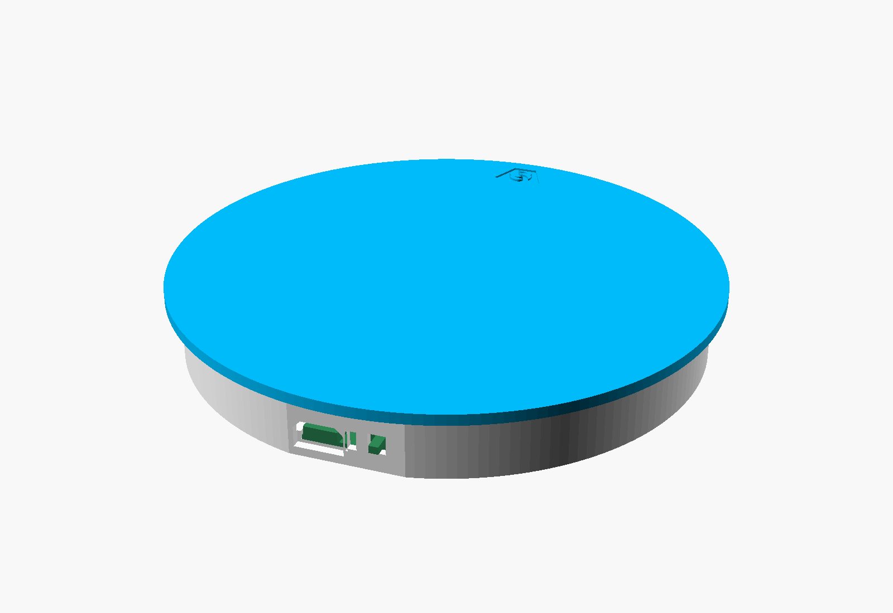
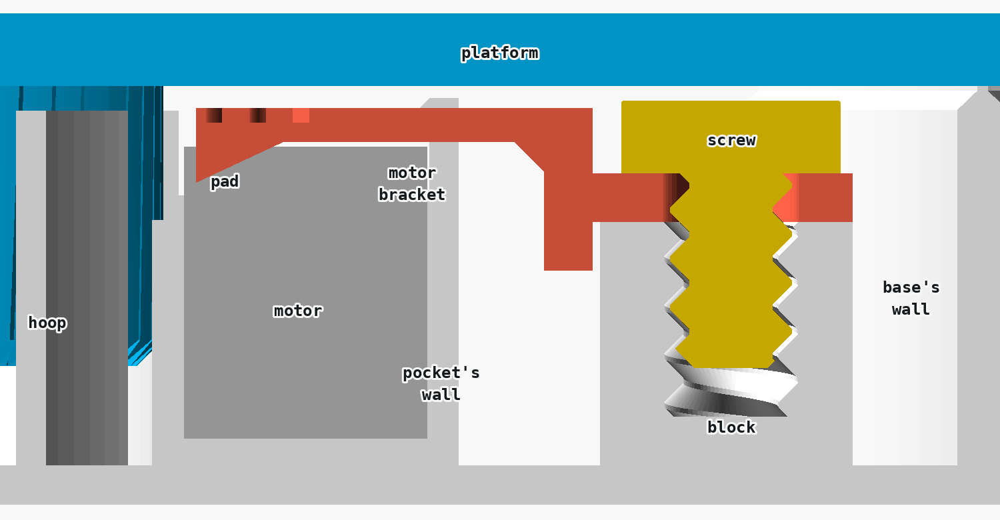
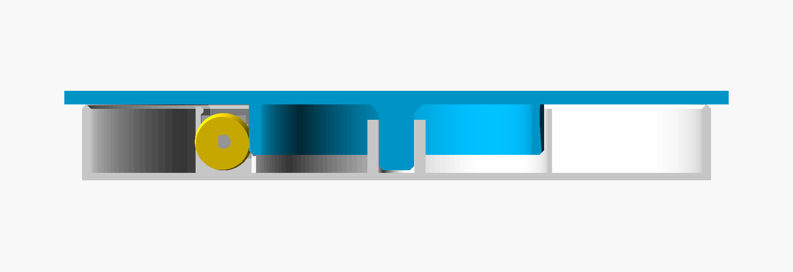
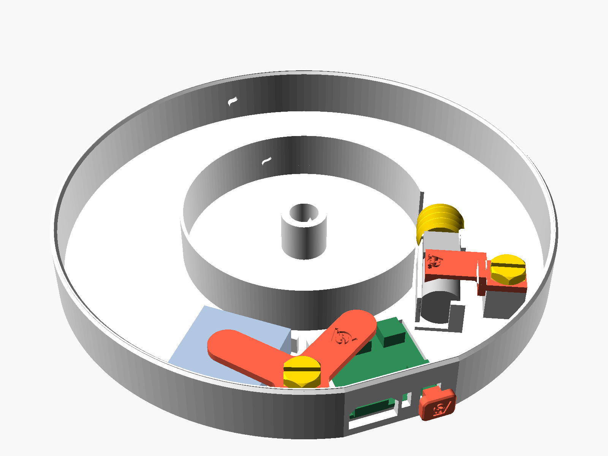
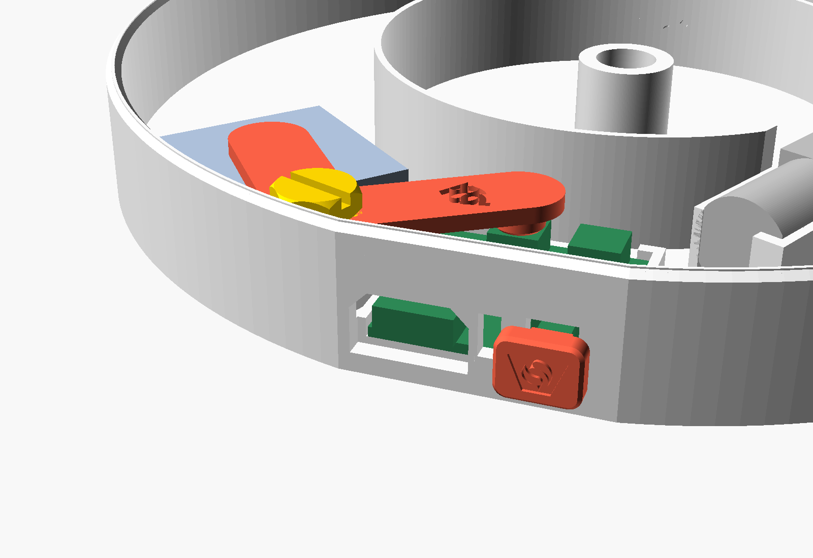
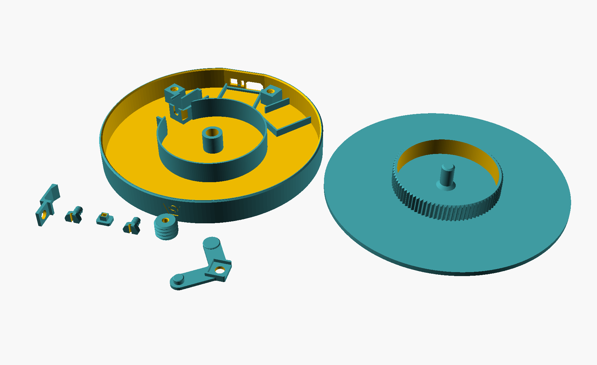

# Rechargeable Power Kit turntable

Turntable for Bambu Lab's Rechargeable Power Kit (ZC003): an N20 gear motor, a 500 mAh LiPo battery and a board with a USB-C socket and a push switch. A printed worm on the motor turns a hoop of teeth under the platform; the number of teeth sets the speed. Seven printed parts, the screw twice, and the kit, nothing else. V6: V5 is printed and tested, its bracket locks board and battery, the motor lies a bit loose under its hook; the motor bracket and the base of V6 are not printed yet.

| File | What |
|---|---|
| `rechargable_motor_power_kit_turntableV6.scad` | the generator, standalone, no libraries. `part`: all parts on the bed, assembly, assembly without the platform, section, base, platform, worm, bracket, motor_bracket, screw, cap |
| `rechargable_motor_power_kit_turntableV6_base.stl`, `_platform.stl`, `_worm.stl`, `_bracket.stl`, `_motor_bracket.stl`, `_screw.stl`, `_cap.stl` | exported at the defaults, as they print; platform, worm, bracket, screw and cap are the shapes of V5, triangle for triangle |
| `rendered_parts/` | every part under its name |
| `archive/` | V1 to V5 |
| `readme_hgc.md` | original goal |
| `image.png`, `image copy.png` | the kit and its wiring, Bambu Lab's pictures |
| `Rechargeable Power Kit-ZC003 model/` | Bambu Lab's CAD model of the kit, source of every kit dimension in the script; not committed |

## Parts

| Part | Qty | Note |
|---|---|---|
| base, platform, worm, bracket, motor bracket, cap | 1 each | printed, 46.0 / 58.7 / 1.2 / 1.3 / 0.54 / 0.18 cm³ solid at the defaults |
| screw | 2 | printed, 0.24 cm³ each: one for the bracket, one for the motor bracket |
| Bambu Lab Rechargeable Power Kit ZC003 | 1 | motor, battery, board; its five screws are not used |
| USB-C cable | 1 | to charge |
| flat screwdriver | | for the printed screws, blade up to 1.2 thick |
| graphite | | a soft pencil or powder, on the rail |

## V6 against V5

| | V5 | V6 |
|---|---|---|
| print | printed and tested 2026-11-13: the bracket locks board and battery; the motor lies a bit loose | unprinted |
| motor's hold | a hook 0.2 above the gearbox, walls 0.1 beside it | a motor bracket, held by a second screw, presses it down and away from the hoop |
| motor bracket | | new: a foot on a block beside the can, an arm 1.4 thick and 10 wide across the can, a pad on the can's shoulder 25° from its top, towards the hoop. The pad reaches 0.4 (`motor_press`) into the can, so the arm bends up by that |
| force on the motor | | about 3 to 4 N down and half of that away from the hoop, by estimate |
| base | | a block 10 × 10.4, 11.6 high, with a thread, 5.8 beside the pocket's wall |
| gearbox's boss in its slot | 0.3 on each side: the worm's push bends the snap tab until the boss meets the edge, 0.39 at the worm | 0.1 (`boss_clearance`) on the side away from the hoop: the edge stops the motor, 0.16 at the worm |
| gives way between worm and hoop under the worm's push | 0.71 | 0.48: pin 0.15, motor 0.16, shaft and bore about 0.17 |
| left of V4's thread between the teeth then | 0.39 | 0.62 |
| base at `rpm` 12 | Ø110 | Ø112, for the block |
| to print | | base, motor bracket and a second screw; platform, worm, bracket and cap as V5 |

## V5 against V4

| | V4 | V5 |
|---|---|---|
| print | the bracket of V2, printed with V3: it keeps board and battery in, but does not press them down | printed and tested 2026-11-13: locks board and battery |
| bracket's arms | end 0.4 above the battery and the socket of the battery's plug | end in pads that reach 0.4 (`hold_press`) into the two: screwed down, the arms bend up by it and press |
| arm over the board | 4.2 thick, stiff | 2 thick as the other, a spring, with a Ø6 pad 3.0 high on the socket |
| arm over the battery | 2 thick | 2 thick, with a Ø10 pad 0.8 high, its edge chamfered |
| force of an arm | none | 4 to 9 N by estimate; on the battery at most 0.12 N/mm² |
| to print | | the bracket; with V4's worm two small parts on V3's base and platform |

## V4 against V3

| | V3 | V4 |
|---|---|---|
| print | printed and tested 2026-11-12: the rail works well; under a heavy load the teeth skip, with a repeating sound | unprinted |
| worm | Ø13 over the thread | Ø13.6: 0.3 more radius (`worm_oversize`), the same thread |
| thread between the hoop's teeth | 0.8 | 1.1 |
| left of that when worm and hoop are pushed 0.71 apart | 0.09 | 0.39 |
| worm above the floor | 0.6 | 0.3 |
| to print | | the worm; base, platform, bracket, screw and cap as V3 |

Why the teeth skip: the 45° flanks push worm and hoop apart about as hard as the worm drives. What gives way, by the model's sizes; the last two rows are estimates:

| Gives way | At the worm |
|---|---|
| platform's pin in its tube, 8.3 on 8.0 | 0.15 |
| motor between its walls, 0.1 on each side | 0.22 |
| the snap tab beside the gearbox bends, until the gearbox's boss meets the edge of its slot (4.6 for Ø4) | to 0.39, at about 3 N |
| motor's shaft in its bearing, worm on the shaft | about 0.17 |
| together | 0.71 |

## V3 against V2

| | V2 | V3 |
|---|---|---|
| print | the platform of V1, which has the same bearing, printed and tested 2026-11-12: it wobbles | printed and tested 2026-11-12: the platform runs well on the rail |
| platform's load | on the pin's Ø6 end, on the floor in the tube; the platform rocks until its underside meets the wall, 0.4 below | on the top of the base's wall, at r 70 |
| base's wall | 16.8 high, flat top | 17.2 high; its top is a rail, chamfered at 45° from both sides, the last layer 0.42 wide (`rail_width`) |
| pin | stands on the floor | ends 0.6 (`pin_gap`) above the floor and only centres the platform |
| friction | brakes at r 2 | brakes at r 70, about 35 times as much for the same load; graphite on the rail |
| `tilt_gap` | 0.4 | gone |
| to print | | base and platform; worm, bracket, screw and cap as V2 |

## V2 against V1

| | V1 | V2 |
|---|---|---|
| print | base printed 2026-11-12 (Elegoo Centauri Carbon 2, 0.2 mm): motor, board and battery fit | base as V1, plus a block with a thread on the wall and a wider opening for the switch |
| board and battery | lie loose and fall out when the base is handled | a bracket over both, held by a printed 5 mm screw |
| switch | plunger 2.1 proud of the panel, hard to press all the way: the board slides up to 0.6 back in its seat | a cap on the plunger's tip, its head 3 off the panel |
| printed parts | 3 | 6 |
| size, speed, gear | | unchanged |

## Size and speed

| Parameter | Default | Does |
|---|---|---|
| `turntable_d` | 150 | the platform's diameter; at least the base + 2 |
| `rpm` | 6 | wanted turns per minute. The hoop gets `motor_rpm` / `rpm` teeth, rounded; the script echoes the real speed |
| `motor_rpm` | 500 | the motor's speed, as Bambu Lab states it for the kit |
| `tooth_pitch` | 2.5 | from tooth to tooth. 2 gives a base 14 smaller for the same speed, with finer teeth; 3 a base 12 larger, with coarser ones |
| `platform_thickness` | 3 | |

One turn of the worm moves the hoop one tooth, so slower means more teeth, a larger hoop and a larger base. The base is always as small as the hoop and the kit beside it allow; a larger `turntable_d` only widens the platform. At `motor_rpm` 500 and `tooth_pitch` 2.5:

| `rpm` | Teeth | Real rpm | Seconds per turn | Hoop | Base | Smallest `turntable_d` |
|---|---|---|---|---|---|---|
| 3 | 167 | 2.99 | 20.0 | 132.9 | 208 | 210 |
| 4 | 125 | 4.00 | 15.0 | 99.5 | 174 | 176 |
| 5 | 100 | 5.00 | 12.0 | 79.6 | 154 | 156 |
| 6 | 83 | 6.02 | 10.0 | 66.0 | 142 | 144 |
| 8 | 63 | 7.94 | 7.6 | 50.1 | 126 | 128 |
| 10 | 50 | 10.00 | 6.0 | 39.8 | 116 | 118 |
| 12 | 42 | 11.90 | 5.0 | 33.4 | 112 | 114 |

The speed is not exact: a DC motor slows down under load and as the battery empties. To correct it, count the platform's turns in a minute, multiply by the teeth and put the result in `motor_rpm`.

## How it works

| | |
|---|---|
| worm | on the motor's D-shaft, Ø13.6 over the thread, 10.5 long: 0.3 (`worm_oversize`) more radius than the Ø13 the base and the hoop are laid out for, so the thread stays between the teeth when the worm's push drives the two apart. Its thread is the 45° thread of `fdm_optimized_screws` at 2.5 pitch, 1.0 deep, so it prints standing without support. Its root is 0.8 wider than the motor, so the hoop's teeth pass the motor |
| hoop | 83 teeth under the platform, pitch Ø66.0: involutes with a 45° pressure angle, which fit the thread's straight flanks, leaning 3.8° like the thread. Their lower ends are chamfered, so they find their way into the worm |
| play | laid out for 0.35 along the hoop (`backlash`) and 0.25 between the thread's crest and the bottom of the teeth (`tip_clearance`). The larger worm is 0.6 wider between the teeth: it runs only with worm and hoop at least 0.13 further apart than drawn, which the pin's play (0.15) and the motor's (0.22) allow. Pushed apart by both, 0.49 is left along the hoop. The worm only ever pushes one way, so the play costs nothing |
| bearing | the platform's flat underside lies on the top of the base's wall and slides on it, at r 70 (68.4 along the panel): the widest circle the base has, so the platform cannot rock |
| rail | the wall's top: 45° chamfers from both sides leave a ridge 0.42 wide (`rail_width`, one extrusion width) and one layer high, so the last layer is a single line. Rub graphite on it |
| pin | the platform's Ø8 pin turns in a tube in the middle of the base and only centres it: its end stays 0.6 (`pin_gap`) above the floor |
| motor | lies in a pocket, flats upright, on a pad that puts the worm 0.6 above the floor. A wall in front of the gearbox with a slot for the shaft, a rib behind the rear beside the terminals, a wall on each side, and a tab whose hook snaps 0.5 over the gearbox. The slot's edge on the side away from the hoop is 0.1 (`boss_clearance`) off the gearbox's boss and stops the motor where the worm's push leans it. A block 0.8 behind the worm's closed end keeps it on the shaft |
| motor bracket | a foot on a block beside the can, on the side away from the hoop, a riser, and an arm across the can, 1.4 thick, 0.2 above the motor: a spring. Its pad lies on the can's shoulder 25° from the top, towards the hoop, and as printed reaches 0.4 (`motor_press`) into the can: the arm bends up by that and presses the motor down on its seat and away from the hoop, against the pocket's wall and the slot's edge. Bent, the arm's end is as high as the hook, 0.5 under the platform. The riser reaches 2 down beside the block with 0.3 play, so the bracket cannot turn with the screw |
| board | lies on two ledges, 1.6 above the floor, behind a flat panel in the wall: two guides along its sides, two stops behind its corners, a wedge on the panel over its front edge. The panel has an opening for the USB-C plug (13 × 7.4, for the plug's grip), an opening for the switch's plunger and the cap's stem (5.4 × 5.3), and a slit that shows the charging light |
| battery | lies in a fence 5 high beside the board, open at the corner where its wire leaves |
| bracket | a plate on a block on the wall, between the board and the battery, with two arms, 2 thick and 10 wide: springs. One ends in a Ø10 pad on the middle of the battery, the other in a Ø6 pad on the socket of the battery's plug at the board's rear. As printed the pads reach 0.4 (`hold_press`) further down than the two are high, so the arms bend up by that and press them down. The board's rear cannot rise over its stops (1.0), the battery not over its fence (5) |
| blocks | the bracket's on the wall, 10 wide, as high as the bracket's underside; the motor bracket's beside the motor, 10 × 10.4, 11.6 high, so that its screw's head ends 0.6 under the platform. Both with a thread 8 deep. The bracket's rim lies around three sides of its block with 0.3 play, so the bracket cannot turn with the screw |
| screw | Ø5, 2 pitch, 45° flanks, 8 long, hex head 9 across the flats with a slot. 5 is the smallest that works in `fdm_optimized_screws`: 4 bends, 3 broke. One holds the bracket's plate, one the motor bracket's foot on its block. The arms' bend presses on the kit, not the screw: turned on, it presses no harder |
| cap | a 9 × 7 head on a stem, which takes the plunger's 2.5 × 2 tip 2.3 deep and holds by friction. The head stands 3 (`cap_travel`) off the panel, so the switch can be pressed all the way, also when the board slides back in its seat |
| guard | a wall around the hoop keeps the wires out of the teeth |
| logo | engraved in the front of the base's wall, in the platform's top face, in the worm's closed end, in the bracket's arm over the board, in the end of the motor bracket's arm and in the cap's face; the screw has no room for it |

## Sizes at the defaults

| | |
|---|---|
| base | Ø142, 17.2 high, flat panel 30 wide at the back |
| platform | Ø150, 3 thick |
| height | 20.2 to the platform's top |
| bracket | 29 × 43, 5.0 high |
| motor bracket | 27 × 10, 6.7 high |
| cap | stands 5.4 proud of the panel |

## Assembly

1. Push the worm onto the motor's shaft, flat on flat, until the shaft's tip stops in it.
2. Press the motor into its pocket: flats upright, the side where the wires leave towards the middle of the base, the shaft down the slot, until the hook snaps over the gearbox.
3. Set the motor bracket on the block beside the motor: its foot on the block, its lip in the gap between the block and the motor's pocket, its arm across the motor, the logo towards the middle of the base. Turn a screw in with a flat screwdriver until the foot lies on the block: the arm bends up a little and presses on the motor.
4. Plug the motor into the board's socket beside the switch (CN-MOTO) and the battery into the one beside it (CN-BAT). The plugs only fit one way.
5. Put the board in tilted, front edge first: USB-C socket and switch into their openings, the front edge under the wedge, then lower the rear behind the two stops.
6. Lay the battery in its fence, the wire towards the board.
7. Set the bracket on the block beside the board: the arm with the logo and the high pad over the board, the other over the battery. Turn the other screw in until the plate lies on the block: the arms bend up a little and press on battery and board.
8. Push the cap onto the plunger's tip from outside, logo upright.
9. Rub graphite on the rail, the ridge on top of the base's wall, all round.
10. Lower the platform, pin into the tube, and turn it a little until the teeth drop into the worm and the platform lies on the rail.
11. Press the cap.

The worm cannot be driven backwards: do not turn the platform by hand, lift it off instead. To take the board out, pull the cap off first.

## Printing

| Part | Orientation | Overhangs |
|---|---|---|
| base | standing | the hook and the wedge, 45°; flat bridges over the three openings in the panel, 9, 5.4 and 2.4 long. The rail narrows upwards: 1.82, 1.42, 1.02, 0.62 and 0.42 wide in its last five layers |
| platform | upside down, top face on the bed, as the STL | none: pin and hoop face up. Its underside, which slides on the rail, is the print's top surface |
| worm | standing on its closed end, bore up, as the STL | the thread's flanks, 45° |
| bracket | upside down, top face on the bed, pads up, as the STL | none |
| motor bracket | on its side, its section on the bed, as the STL: the layers run along the arm | none; the screw's hole lies level, Ø5.6. Sliced with the settings of `v5_elegoo.3mf`, supports on: 50 layers, solid, no support |
| screw, twice | lying on the flat cut into its underside, as the STL | the thread, as in `fdm_optimized_screws` |
| cap | on its face, stem up, as the STL | none |

Made for 0.2 mm layers: the base's wall, the rail's ridge, the floor, the blocks' tops, the bracket's faces and the pin's end are on multiples of 0.2.

The rail's last layer is one line wide, which a slicer only prints with thin walls allowed. Print the base with `Detect thin wall` on. The V3 base sliced in ElegooSlicer 1.5.3.5 with the settings of `v2_elegoo.3mf`, read from the G-code:

| Walls | Rail's last layer, z 17.2 | Layer below, z 17.0 | Rest of the base |
|---|---|---|---|
| classic, `Detect thin wall` off, as `v2_elegoo.3mf` | 69 of 440 mm, in 16 pieces: the platform would ride on them | two 0.42 lines in a 0.62 wide ridge | |
| classic, `Detect thin wall` on | one line all round, 0.46 wide | one line, 0.66 | as with it off, to 0.1 |
| Arachne | one line all round, 0.42 wide | one line, 0.62 | a fifth of the walls' plastic lies more than 0.1 from classic's; the fits of V1's print are untested with it |

## Tuning

| Problem | Change |
|---|---|
| too fast or too slow | `motor_rpm` = counted turns per minute × teeth |
| the teeth still skip under a load | `worm_oversize` 0.4; only the worm changes |
| platform runs rough, slow or not at all without a load | `worm_oversize` 0.2; only the worm changes |
| the teeth bind with `worm_oversize` 0 | `backlash` 0.45; changes the platform |
| worm tight or loose on the shaft | `shaft_clearance`, 0.2 |
| platform still rocks | it stands on the pin: `pin_gap` 1; only the platform changes |
| the rail's last layer is missing or in pieces | slicer: `Detect thin wall` on, or Arachne walls; see Printing |
| motor stalls under a load | more graphite; a lighter load |
| board or battery still loose under the bracket | `hold_press` 0.8; only the bracket changes |
| the bracket's plate does not come down on the block, or presses too hard | `hold_press` 0.2, or `bracket_thickness` 1.6 for softer arms |
| motor still loose under the motor bracket | `motor_press` 0.6; only the motor bracket changes |
| the motor bracket's foot does not come down on its block | `motor_press` 0.2 |
| motor does not go down its slot | `boss_clearance` 0.3; changes the base |
| screw tight or loose in the block | `thread_clearance`, 0.25; changes the base |
| cap falls off | `cap_clearance` 0; only the cap changes |
| cap does not go on | `cap_clearance` 0.2 |
| cap touches the panel before the switch latches | `cap_travel` 4 |

## Checked in the model

| Check | Result |
|---|---|
| V6's motor bracket as it lies screwed down | shares no volume with base, motor, worm, board, battery, bracket, screws or cap; raised 0.4, as its bent end, none with the platform, pushed away, in the middle or towards the motor |
| V6's motor bracket as printed, arm straight | meets the motor only with its pad, on the can from 0.5 to 4.2 towards the hoop |
| motor bracket lifted 3 | free of base and motor: it goes on straight down |
| motor bracket turned about its screw | free of the base at 3° either way, the block stops its lip before 4.5°; the pad rides up the can |
| second screw in its block | shares no volume with the base, the motor bracket or the platform |
| motor moved 0.09 away from the hoop | free; at 0.11 the boss is on the slot's edge, the gearbox on the tab, the can on its wall |
| motor moved 0.09 towards the hoop | free; at 0.11 on the pocket's wall |
| motor raised 1, 3, 6 and 10 | meets the base only at the hook, as in V5: the boss goes down its slot |
| V6's platform, worm, bracket, screw and cap against V5's | the same triangles |
| `rpm` 3, 4, 5, 8, 10 and 12, `tooth_pitch` 2 and 3 | the script runs; the base grows only at `rpm` 12, from 110 to 112 |
| V4's worm, platform where the drawing has it | worm and hoop overlap; pushed 0.10 apart also, 0.15 apart free |
| V4's worm turned through a full turn in six steps, hoop advanced one tooth per turn, platform pushed 0.15 away | never touch |
| a tooth's tip opposite the thread's crest, pushed apart | V3's worm: they meet at 0.75, pass at 0.85; V4's: meet at 1.05, pass at 1.15 |
| V4's worm in the base | free; lowered 0.25 free, 0.35 on the floor |
| `worm_oversize` 0.4 | overlap at 0.20 apart, free at 0.25 |
| V5's base, platform, screw and cap against V3's, its worm against V4's | the same triangles |
| V5's bracket as it lies screwed down, pads on battery and socket | shares no volume with board, battery, base, motor, worm, screw, cap or platform |
| V5's bracket as printed, arms straight | meets battery and socket only with its pads, 0.4 deep, Ø10 and Ø6 |
| V3's worm turned through a full turn in three steps, hoop advanced one tooth per turn | never touch |
| hoop shifted 0.4 × `backlash` either way, V3's worm | free |
| hoop shifted 0.65 × `backlash` either way, V3's worm | the flanks touch |
| motor, worm, board, battery, bracket, screw, cap and platform in their places | touch nothing they should not; platform and base share no volume |
| platform lowered 0.1 | meets the base only in the rail's ridge, r 69.8 to 70.2 |
| platform lowered 0.5, the base's middle | free; at 0.7 the pin is on the floor |
| the rail's width in the base's mesh, at five places round the wall and along the panel | 0.42 in the last layer, then 0.62, 1.02, 1.42, 1.82, and 2.0 from 1.0 below the top |
| base against V2's below the rail | the same, but for the logo, 0.2 higher with the wall's middle |
| board tilted 6°, 0.6 back, then pushed forward | free |
| screw in the block's thread | free all round, 0.25 |
| bracket turned about the screw | free up to 3° either way, the block stops it before 4.5°; touches nothing else at 4.5° |
| bracket lifted 3 | free: it goes on straight down |
| V4's bracket: board's rear raised 0.4, battery raised 0.3 | free; raised 0.7 and 0.6 the bracket is in the way |
| cap pushed in 2.8 | free; at 3.2 its head is on the panel |
| the collisions again at `rpm` 3, 4 and 10 and at `tooth_pitch` 2 and 3 | the same (V2); V3: the rail measured again at `rpm` 3 and 10 and at `tooth_pitch` 2, 0.42 |

## Open points

| | |
|---|---|
| motor speed | 500 rpm is Bambu Lab's number for the kit; at which voltage is not stated, and the board feeds the motor from the battery, 3.7 V. Expect to correct `motor_rpm` |
| direction | set by the plugs; unknown which way the platform turns |
| torque | a worm with 45° flanks loses most of the motor's power to friction, about 85 to 90 % by estimate. V3 turns the platform; how much load before the motor stalls is unknown, the teeth skip first |
| skipping | whether V4's larger worm ended it is not reported. V6's base adds the stop beside the gearbox's boss. If the teeth still skip: the worm closer by the pin's play; not built, needs a new base |
| motor bracket | unprinted. Its force is an estimate from the arm's size, about 3 to 4 N; the motor's real height above the block decides. More than 0.4 makes the arm thinner, so it hardly presses harder |
| run time | unknown |
| shaft | 2.7 across the flat by the CAD model; N20 shafts usually have 2.5. The bore follows the CAD model, which fits both |
| charging light | its place on the board is read from the photo, not from the CAD model |
| USB-C plug | the opening is for a grip up to 13 × 7.4 |
| load | only its weight holds the platform down; a platform much wider than the base tips with a load on its edge |
| rail | works well in V3's print. The load brakes at r 70: about 14 mN·m for each 100 g at a friction of 0.2, by estimate (on the pin's end: 0.4). Unmeasured how much the motor still turns, and how graphite, the ridge's seam and the lines of the platform's underside run on each other |
| bracket | V5's pressing arms lock board and battery (print, 2026-11-13). Their force is an estimate from the arms' size, 4 to 9 N at 0.4. PLA gives way under a lasting bend: the force drops with time, the pads stay on |
| screw | the printed 5 mm screw in its block holds the bracket (print, 2026-11-13) |
| cap | its hold on the tip is unprinted; the tip's size is from the CAD model, the plunger's travel a guess from its 2.5 long collar |
| board's play | the board still slides up to 0.6 in its seat, 0.3 before and 0.3 behind it; the cap makes that harmless. The stops could come closer once the cap is tested |
