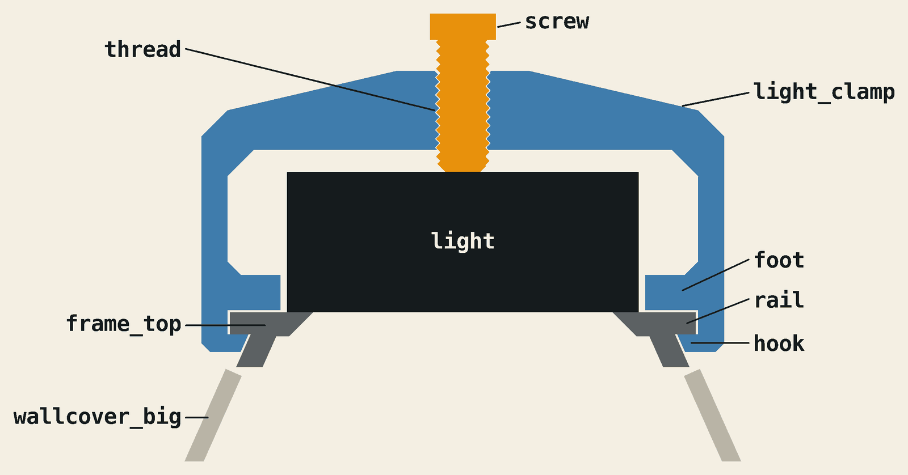
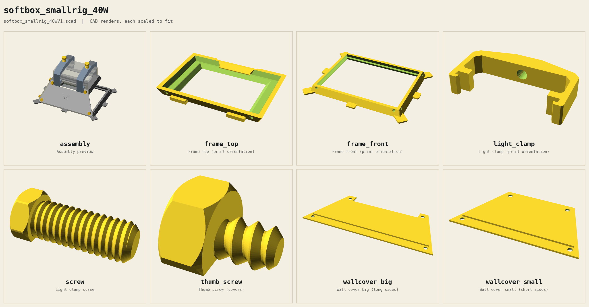

# Softbox for the SmallRig RM 40C

Fully printed softbox for the SmallRig RM 40C (40 W) video light; the sizes are parameters. Successor of `01_published_or_archived/cuboid_video_light_softbox` (V1 to V6, for the Ulanzi VL120). V1 here answers `problems/readme_hgc.md`: the light is held by two separate clamps instead of two towers on the frame top. **Not printed yet.**

| File | What |
|---|---|
| `softbox_smallrig_40WV1.scad` | the generator, standalone, no libraries. `part`: all parts on the bed, assembly, and each part in its print orientation |
| `softbox_smallrig_40WV1_frame_top.stl`, `_light_clamp.stl`, `_screw.stl`, `_wallcover_big.stl` | the parts to print on top of a V6 build, at the defaults, as they print |
| `rendered_parts/` | every part under its name |
| `section.png` | names inside the clamp: foot, rail, hook, thread |
| `problems/` | the V6 print's problems, with photos |
| `cuboid_video_light_softboxV5.3mf`, `V6.3mf`, `V62.3mf`, `V5.stl` | print files of the V5 and V6 builds |
| `readme_hgc.md` | original goal |

## V1 against cuboid_video_light_softbox V6

| | V6, as printed | V1 |
|---|---|---|
| screws on the light | 7.5 from the light's ends, on its rounded edge: only one of the two locks | 22 from the ends; the clamps slide along the rails, about 35 to 42 from the middle |
| force of a tightened screw | pulls the tower's legs across their layers; a tower broke at its roof | runs around a clamp printed on its side, along its layers; the hooks pull at rails right beside the light |
| frame_top | plate, band and two towers; prints standing | plate, band and four rails; prints flat on its back face |
| frame_top, sliced | 3 h 44 min, 87 g, 40 % of it support | 1 h 02 min, 35 g, no support |
| light_clamp | part of frame_top | own part, 2 ×: 46 min, 25 g each, no support |
| screw | 19 long | 30 long, for the 18 thick roof |
| long covers | one plain, one with the tripod cutout | both with the cutout: it makes room for the hooks |
| tripod notch in the rim | level floor | floor drops outwards at 45°, so the wall over it is no bridge on the bed |
| small logo | on a tower | in the plate under the light's +x end, and in the side of each clamp that lies on the bed |
| frame_front, wallcover_small, thumb_screw | | unchanged |

Sliced with the settings of `cuboid_video_light_softboxV6.3mf`: Bambu Lab A2L, 0.24 mm, 2 walls, 15 % grid, tree(auto) support on, Bambu Studio 2.9.1.

## What to print

| Part | Qty | Prints | With a V6 build |
|---|---|---|---|
| frame_top | 1 | on its back face | print; replaces V6's |
| light_clamp | 2 | on its side | print; more walls make it stiffer |
| screw | 2 | lying on its flat | print; V6's are too short |
| wallcover_big | 2 | flat, lip up | print 1 for the +y side; V6's `wallcover_tripod` is the same part and stays on the -y side. V6's plain `wallcover_big` no longer fits |
| frame_front | 1 | on its front face | keep |
| wallcover_small | 2 | flat, lip up | keep |
| thumb_screw | 16 | lying on its flat | keep |

## Assembly

1. Screw the four covers to frame_top and frame_front, as before.
2. Lay the light on the plate, its 1/4" thread towards the notch.
3. Lower a clamp over the middle of the light, where the rails have their gap, and slide it outwards until its hooks are under the rails. The second clamp to the other side.
4. Tighten both screws. Mount the tripod head last: it stands in the gap.
5. To take the light out: loosen the screws, slide the clamps back to the middle, lift them off. A loose clamp stands on its feet and stays hooked.

## Sizes

| Parameter | Default | From |
|---|---|---|
| `light_length`, `light_width`, `light_height` | 129, 83, 36 | the V6 print, measured in its 3mf; SmallRig's data sheet says 128 × 80 × 32 |
| `softbox_depth` | 80 | the V6 print |
| `tripod_cutout_depth` | 15 | the V6 print |
| `clamp_width`, `clamp_roof`, `clamp_leg` | 22, 18, 6 | new |
| `clamp_rail_width`, `clamp_rail_thickness`, `clamp_clearance` | 7, 5, 0.5 | new |
| everything else | | V6's defaults |

## Checked in the model

| Check | Result |
|---|---|
| frame_front, wallcover_big, wallcover_small, thumb_screw against the meshes in the V6 3mf | same size, same volume to 0.001 cm³ |
| a loose clamp swept from the gap to the rails' ends, against frame_top | no overlap |
| a clamp lifted 0.3 past the rails | all four hooks bite, 22 × 4.3 each |
| clamps against both long covers with their screw heads, against a 128 × 80 × 32 light, screw in the clamp's thread | no overlap |
| frame_top, light_clamp, screw sliced with support on | no support |
| faces more than 50° off vertical, off the bed | frame_top 1.5 cm² (V6: 59.8), light_clamp 0.8 cm²: logos and thread flanks |

## Open

| | |
|---|---|
| print | nothing of V1 is printed |
| thread in the clamp | first 12 mm thread printed lying, its axis level with the bed; 0.25 clearance as the others |
| hook under the rail | 0.5 clearance, not tested |
| where the screws land | 22 from the light's ends, in the middle of its width: on the magnet pad at one end, between fan and knob at the other. Read from the photos, not measured |
| tripod head | the rails stick out 7 beyond the frame's top edge, from 29 off the middle outwards; a head wider than 57 at the plate's level touches them |
