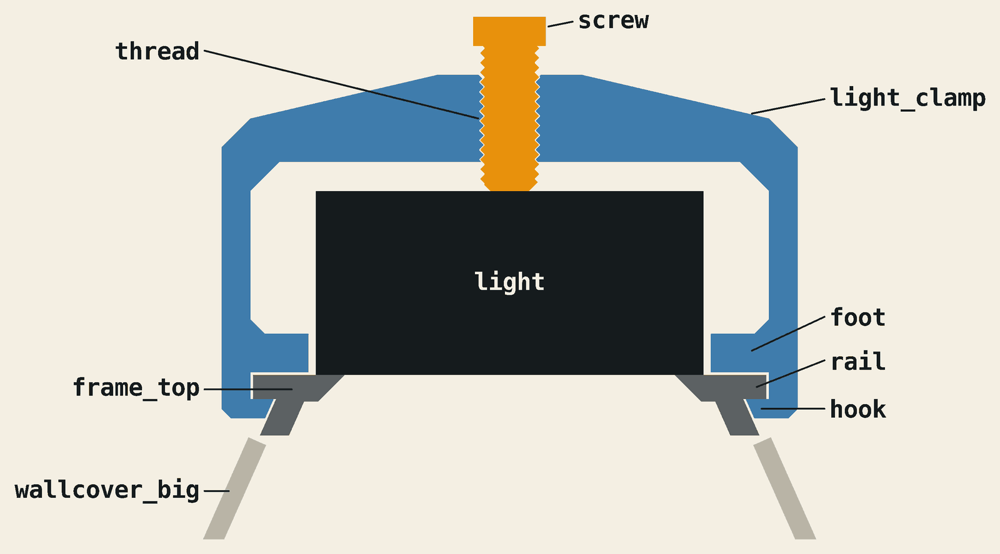
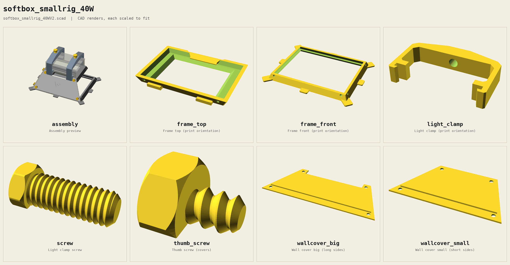

# Softbox for the SmallRig RM 40C

Fully printed softbox for the SmallRig RM 40C (40 W) video light; the sizes are parameters. Successor of `01_published_or_archived/cuboid_video_light_softbox` (V1 to V6, for the Ulanzi VL120). The light is held by two separate clamps that hook under rails of the frame top.

| Version | State |
|---|---|
| V1 | printed 2026-11-28: the concept works, but the light is thicker than the clamps allow and does not fit (`problems/v6p2`) |
| V2 | taller clamps, nothing else changed. **Not printed yet** |

| File | What |
|---|---|
| `softbox_smallrig_40WV2.scad` | the generator, standalone, no libraries. `part`: all parts on the bed, assembly, and each part in its print orientation |
| `softbox_smallrig_40WV2_light_clamp.stl` | the part to print on top of a V1 build |
| `softbox_smallrig_40WV2_frame_top.stl`, `_screw.stl`, `_wallcover_big.stl` | same as V1's; with the clamp, the parts to print on top of a V6 build |
| `rendered_parts/` | every part under its name |
| `section.png`, `section.py` | names inside the clamp: foot, rail, hook, thread; the script draws it from the newest version |
| `archive/` | V1 |
| `problems/` | the V6 print's problems; `v6p2/`: the V1 print's |
| `cuboid_video_light_softboxV5.3mf`, `V6.3mf`, `V62.3mf`, `V5.stl`, `v6p2.3mf` | print files of the V5, V6 and V1 builds |
| `readme_hgc.md` | original goal |

## V2 against V1

| | V1, as printed | V2 |
|---|---|---|
| light's thickness | 36 in the script, 32 by SmallRig's data sheet | about 38, read from the photo of its end (80 wide as the scale); not measured |
| clamp's roof above the plate | 37: the clamp does not go over the light | 44 |
| light that fits | up to 35.5 | 33 to 42.5, with the same 30 long screws |
| light_clamp | 119 × 64 × 22 | 119 × 71 × 22 |
| frame_top, screw, covers, frame_front, thumb_screw | | unchanged, same volume to 0.001 cm³ |

## V1 against cuboid_video_light_softbox V6

| | V6, as printed | V1 |
|---|---|---|
| screws on the light | 7.5 from the light's ends, on its rounded edge: only one of the two locks | 22 from the ends; the clamps slide along the rails, about 35 to 42 from the middle |
| force of a tightened screw | pulls the tower's legs across their layers; a tower broke at its roof | runs around a clamp printed on its side, along its layers; the hooks pull at rails right beside the light |
| frame_top | plate, band and two towers; prints standing | plate, band and four rails; prints flat on its back face |
| frame_top, sliced | 3 h 44 min, 87 g, 40 % of it support | 1 h 02 min, 35 g, no support |
| light_clamp | part of frame_top | own part, 2 ×: 46 min, 25 g each, no support |
| screw | 19 long | 30 long, for the 18 thick roof |
| long covers | one plain, one with the tripod cutout | both with the cutout: it makes room for the hooks |
| tripod notch in the rim | level floor | floor drops outwards at 45°, so the wall over it is no bridge on the bed |
| small logo | on a tower | in the plate under the light's +x end, and in the side of each clamp that lies on the bed |
| frame_front, wallcover_small, thumb_screw | | unchanged |

Sliced with the settings of `cuboid_video_light_softboxV6.3mf`: Bambu Lab A2L, 0.24 mm, 2 walls, 15 % grid, tree(auto) support on, Bambu Studio 2.9.1. The V1 print itself (`v6p2.3mf`): 0.2 mm, 2 walls, 6 % infill, support off.

## What to print

| Part | Qty | Prints | With a V1 build | With a V6 build |
|---|---|---|---|---|
| light_clamp | 2 | on its side | print | print |
| frame_top | 1 | on its back face | keep | print |
| screw | 2 | lying on its flat | keep | print; V6's are too short |
| wallcover_big | 2 | flat, lip up | keep | print 1 for the +y side; V6's `wallcover_tripod` is the same part |
| frame_front | 1 | on its front face | keep | keep |
| wallcover_small | 2 | flat, lip up | keep | keep |
| thumb_screw | 16 | lying on its flat | keep | keep |

## Assembly

1. Screw the four covers to frame_top and frame_front, as before.
2. Lay the light on the plate, its 1/4" thread towards the notch.
3. Lower a clamp over the middle of the light, where the rails have their gap, and slide it outwards until its hooks are under the rails. The second clamp to the other side.
4. Tighten both screws. Mount the tripod head last: it stands in the gap.
5. To take the light out: loosen the screws, slide the clamps back to the middle, lift them off. A loose clamp stands on its feet and stays hooked.

## Sizes

| Parameter | Default | From |
|---|---|---|
| `light_length`, `light_width` | 129, 83 | the V6 print, measured in its 3mf; SmallRig's data sheet says 128 × 80 |
| `light_height` | 38 | the photo in `problems/v6p2`; the data sheet says 32. Only the clamps follow it |
| `light_headroom` | 6 | room under the clamps' roofs that the screws take up |
| `softbox_depth` | 80 | the V6 print |
| `tripod_cutout_depth` | 15 | the V6 print |
| `clamp_width`, `clamp_roof`, `clamp_leg` | 22, 18, 6 | V1 |
| `clamp_rail_width`, `clamp_rail_thickness`, `clamp_clearance` | 7, 5, 0.5 | V1 |
| everything else | | V6's defaults |

## Checked in the model

| Check | Result |
|---|---|
| V2's frame_top, screw, wallcover_big against V1's STLs; frame_front, wallcover_big, wallcover_small, thumb_screw against the meshes in the V6 3mf | same size, same volume to 0.001 cm³ |
| every part exported with OpenSCAD 2021.01 (CGAL) and with the nightly (lazy union, Manifold) | same volumes |
| a loose clamp swept from the gap to the rails' ends, against frame_top | no overlap |
| a clamp lifted 0.3 past the rails | all four hooks bite, 22 × 4.3 each |
| a loose clamp over a light 38, 42.5 and 43.4 thick | no overlap; 44 touches the roof |
| clamps against both long covers with their screw heads; screw in the clamp's thread | no overlap |
| V1's frame_top, light_clamp, screw sliced with support on | no support |

## Open

| | |
|---|---|
| print | V2's clamps are not printed |
| light's thickness | 38 is read from a photo; a caliper reading where the clamps cross it (22 from each end) would settle it |
| where the screws land | 22 from the light's ends, in the middle of its width: on the magnet pad at one end, between fan and knob at the other. Read from the photos, not measured |
| thread in the clamp, hooks on the rails with the light in | not reported for the V1 print |
| clamp's thread under load | it prints lying; a lying 16 mm thread split along a layer in `mikrofonarm_tischklemme` V3 (PLA, tightened with a T bar). Here the thread sits in the middle of the roof and the screw has no lever: tighten by hand, and print the clamps with more walls |
| tripod head | the rails stick out 7 beyond the frame's top edge, from 29 off the middle outwards; a head wider than 57 at the plate's level touches them |
