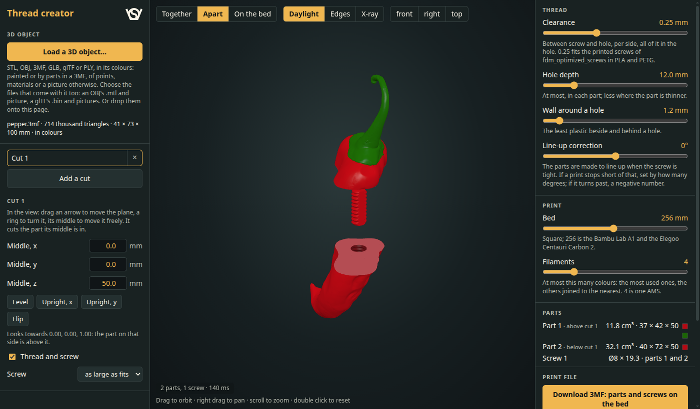

# Thread creator webapp

Cuts a multicolour 3D object into parts that screw together: planes placed with the mouse, a threaded hole in both faces of each cut, a printed screw between them. The parts keep their colours; the 3MF has every part and screw on the bed in its filaments. Goal in `readme_hgc.md`.

| Start | |
|---|---|
| `deno task start` here, then http://127.0.0.1:8780 | the app; reachable from this computer only, keeps nothing on the server |
| `deno task start 8781` | on another port |
| `deno task test` | the tests, see Checks |

Needs [Deno](https://deno.com) and a browser with WebGL2.

## Use

| Step | Control |
|---|---|
| 1. Object | Load a 3D object…, or files dropped onto the page: STL, OBJ, 3MF, GLB, glTF, PLY with their colours (the Lichterkette app's readers); a 3MF of several objects gets a list. Its numbers are mm; it stands on z 0 around the z axis |
| 2. Cuts | a first one level through the middle; Add a cut, × removes one. In the view: arrows move the plane, rings turn it, its middle moves it freely; or Middle x, y, z and Level, Upright x, Upright y, Flip |
| 3. Thread | per cut: Thread and screw on or off; Screw as large as fits (8, 6, 5) or Ø5 to 16 |
| 4. Check | Together, Apart, On the bed; Daylight, Edges, X-ray; Parts lists each part, screw and why a cut has no thread |
| 5. Print | Download 3MF: `<name>_threaded.3mf`; put the listed colours in the slicer's filament slots in that order |
| 6. Assemble | screw the screw into one part until it stops, then screw the other part on: the parts line up when it is tight |

| Setting | Default | Does |
|---|---|---|
| Clearance | 0.25 mm per side | all of it in the hole, as `fdm_optimized_screws` (fits in PLA and PETG, lessons_learned) |
| Hole depth | 12 mm | at most, in each part |
| Wall around a hole | 1.2 mm | least plastic beside and behind a hole |
| Line-up correction | 0° | degrees a print stops short of lining up; negative if it turns past |
| Bed | 256 mm | square |
| Filaments | 4 | most used colours, others joined to the nearest |

## How

| Step | Rule |
|---|---|
| Cut | splits the part the plane's middle is in, along the whole plane; both sides closed by a face; points within 0.0001 mm of the plane are moved onto it |
| Parts | what falls apart is told apart; separate surfaces of the object stay one part where their boxes touch (an eye in a head) or their faces lie on one another |
| Open surfaces | an outline that breaks by up to 0.001 mm goes on (painted 3MFs split triangles mid-edge); a larger break is closed straight and told |
| Hole place | where both faces have the most room, of equal places the one nearest their middle |
| Hole depth | Hole depth, or less where the part's surface comes within hole radius + wall |
| Hole | 45° lead-in at the face, thread, end closing at 45° to a flat ≤ 4 wide (a bridge when upright on the bed) |
| Screw | headless, both ends chamfered 1, 1 mm shorter than both holes take; lies on the flat cut 0.15 × Ø off its underside |
| Line-up | the screw stops in the first part with its flanks towards the face; the second part is tight once its thread lies on the other flanks: the upper hole's thread is 2 × clearance further along its axis (90° at 0.25), plus the correction |
| Colours | the object's triangles keep their filament; cut faces and holes print in the part's own filament: the one most of its cut faces' edge borders |
| Bed | each part on its largest cut face; rows from the front, deepest first, in the bed's middle |
| 3MF | an object per part and screw; its own filament in `Metadata/model_settings.config`, other filaments as Bambu Studio's `paint_color`, colours as base materials |

| Thread | From `../01_published_or_archived/fdm_optimized_screws/fdm_optimized_screws.scad` |
|---|---|
| Profile | one start, right-handed, 2 mm pitch, 45° flanks, ridge 0.8 high, crest 0.2 |
| Smallest | Ø5 (Ø4 bends, Ø3 breaks) |
| Screw | printed lying, as there; no head here |

## Checks

| Check | Result |
|---|---|
| `deno task test` | 42 pass: loops and ears, the cut, the thread, parts and holes, filaments, the 3MF read back, the worker, the viewer on Mesa |
| Thread against the `.scad` file in OpenSCAD 2021.01 (`test/thread_reference.scad`) | rod Ø8 × 20 and hole Ø8 × 12: every OpenSCAD point within 0.010 mm of this app's shape; volumes 807.8 / 808.6 and 527.4 / 527.8 mm³ |
| Bambu Studio 2.9.1 command line, re-export | objects, each one's filament and the paint kept |
| Same, sliced with the A1 settings of `qtip_container_veryos.3mf` | white and red blocks cut in the red: the red part all filament 2, the other red to 12 mm then white, the screw filament 1 |
| Real files | `pepper.3mf` (714 thousand triangles): read 1.4 s, cut and threaded 0.8 s, 3MF 7.9 MB in 1.4 s; `rainbow_dragon.3mf`: 14 parts, no room for threads, told |
| Headless Chrome | load, three views, a second cut, download; no console errors |

| Not done | |
|---|---|
| Print | nothing printed: clearance and line-up untested in this joint |
| Logo | not engraved: the parts are the user's objects; a cut face (hidden once assembled) would have room |
| Saving | cuts are lost on reload |
| Surfaces | the source's own holes stay; an object whose surface is open where it is cut gets faces as good as the outline allows |

## Files

| File | What |
|---|---|
| `webapp/index.html`, `style.css`, `client.module.js` | the page |
| `webapp/worker.module.js` | reads, cuts, threads and exports away from the page |
| `webapp/cut.module.js`, `polygon.module.js` | welding, the cut, faces; loops and ear cutting |
| `webapp/thread.module.js`, `piece.module.js` | thread, hole, screw; cuts to parts, joints and the bed |
| `webapp/color.module.js`, `export.module.js` | filaments; the 3MF |
| `webapp/viewer.module.js`, `gizmo.module.js` | the 3D view; the plane's handles |
| `webapp/mesh_file*.module.js`, `texture.module.js`, `dom.module.js`, `control.module.js` | from `../lichterkette/webapp` |
| `webapp/serve.js` | static server, port 8780 |
| `webapp/test/` | the tests; `thread_reference.scad` |
