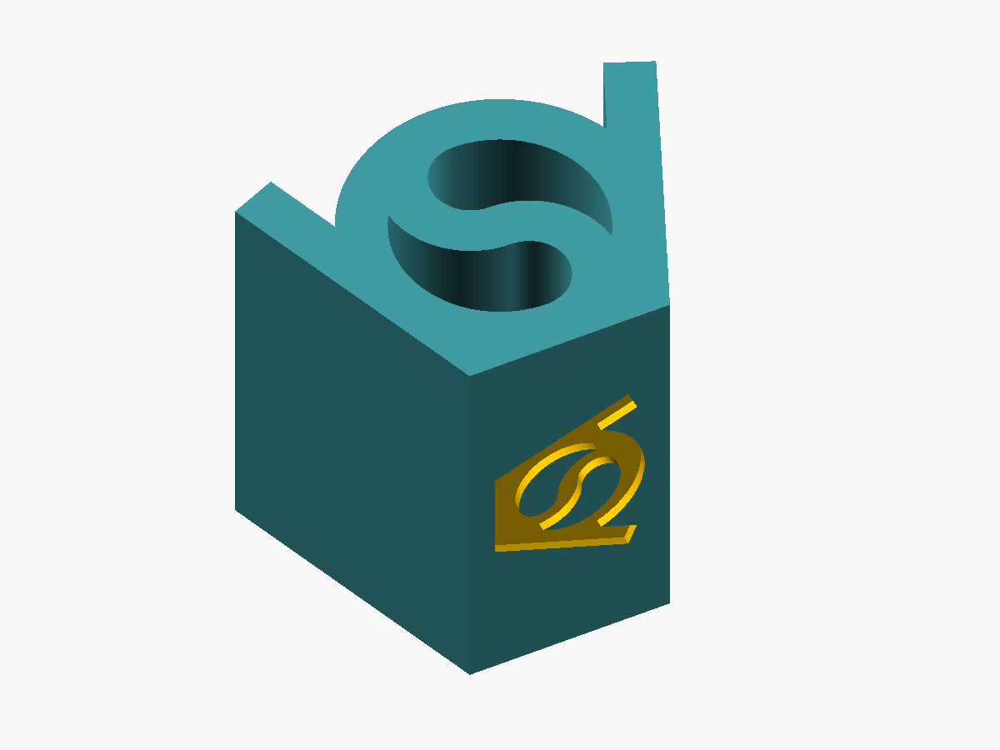
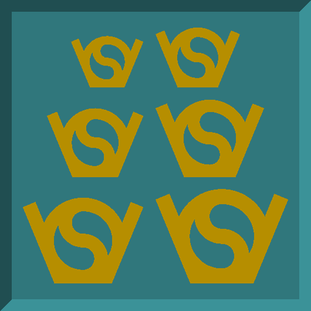

This is a simple demonstrative object of the VeryOS brand. 
VeryOS stands for Very Open Source and highlights the phylosophy of sharing knowledge with everybody to improve well being and technical advancement for everybody!

the project is a simple 2d extrusion of the veryos logo. at the bottom of the logo there is the logo also 'engraved'

`veryos_logo_cube.scad` builds the logo from circles and rectangles with the
measures of `veryos_logo.svg`, so it needs no external file and the curves stay
smooth at any size.

## parameters

- `logo_width`: width of the logo (default 50 mm).
- `depth`: extrusion, front face to back face (default 50 mm).
- `engraving_margin`, `engraving_depth`: the logo in the bottom face is as large
  as fits inside the margin, 1 mm deep.

## printing

The model comes lying on its back: every layer is the logo outline, so it
prints without support. The top face is the front; the bed side shows the logo
mirrored. The engraving sits on a wall and reads correctly from outside.

## V2: the same logo from the front and from the side

`V2/veryos_logo_cubeV2.scad` extrudes the logo through the front and through
the side and keeps only what both share, like the two sided Star Wars sign in
`exampletwoside`. The front and the right side each show the whole logo, holes
see-through; the back and the left side show it mirrored. `logo_width` sets the
width and the depth.

Print it standing on its bottom face. The tops of the holes overhang, most at
the top of the ring and under the middle of the S, so they need supports or a
printer that bridges well.

### engraving test

The square bottom face (24 mm at the default size) is an engraving test: the
logo 6, 7, 8, 9, 10 and 11 mm wide (`test_widths`), 1 mm deep. Seen from below
the sizes read like text, two to a row, the smallest at the top left. It prints
on the bed, which is the hardest place for fine engravings: the first layer's
squish closes thin slots. At 6 mm the strokes are 0.68 mm wide and the islands
in the S holes about 1 mm.
