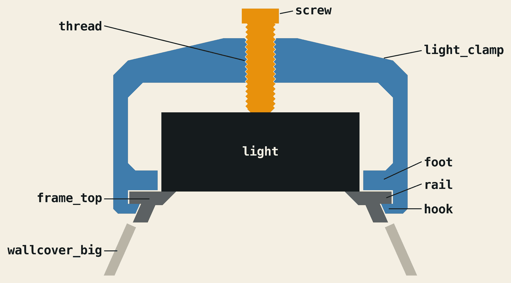
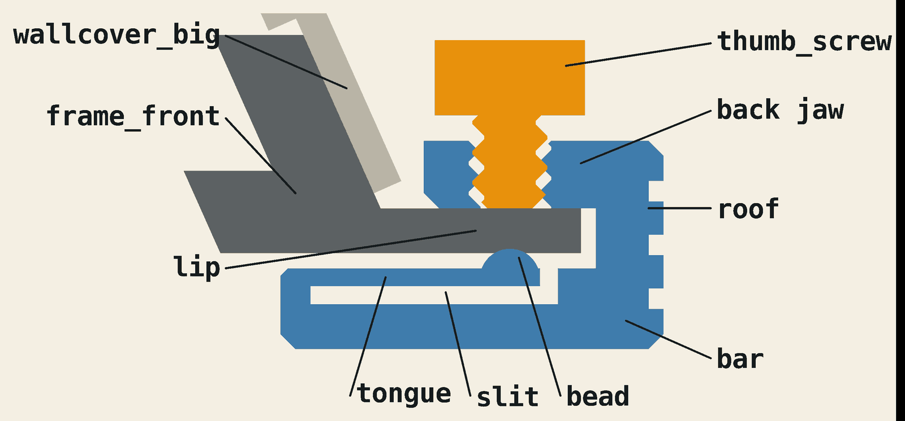
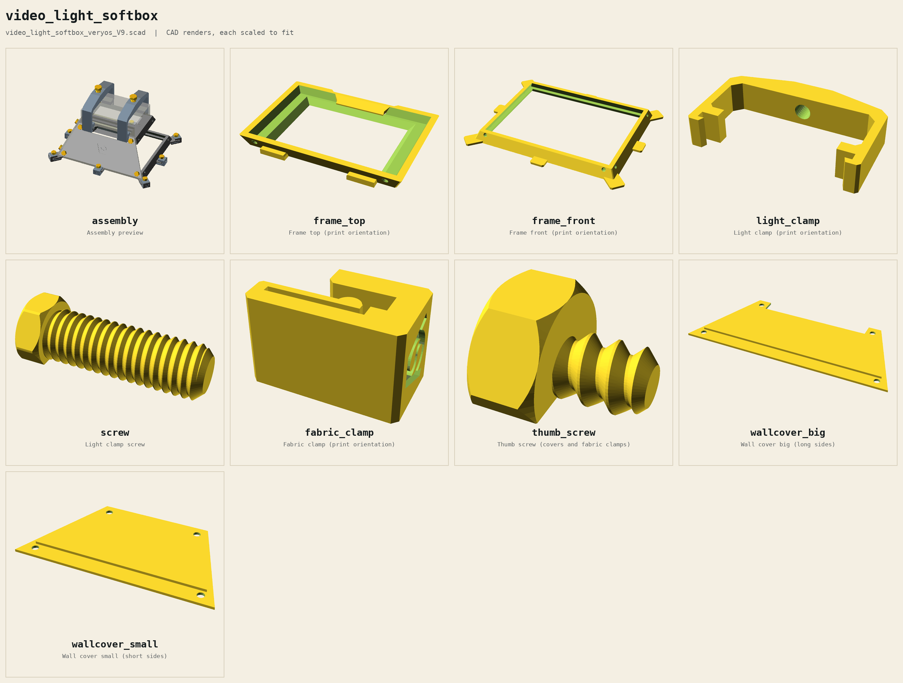

# Video light softbox

Fully printed softbox for a flat cuboid video light. The sizes are parameters; their defaults are those for the SmallRig RM 40C (40 W). The light is held by two separate clamps that hook under rails of the frame top. The diffusion fabric is held on the front frame's lips by eight printed fabric clamps.

| Version | Script | Where | State |
|---|---|---|---|
| V1 to V6 | `cuboid_video_light_softboxV1.scad` … `V6.scad` | `01_published_or_archived/cuboid_video_light_softbox/` | archived. V6 printed for the SmallRig: a clamp tower broke (`problems/readme_hgc.md`) |
| V7 | `video_light_softbox_veryos_V7.scad` | `archive/` | printed 2026-11-28, the print "v6p2": the concept works; the light did not fit because its magnetic honeycomb grid was on (`problems/v6p2`) |
| V8 | `video_light_softbox_veryos_V8.scad` | `archive/` | printed 2026-11-28: the light fits, the screws are a bit short; no way to hold the fabric at the corners (`problems/v8`) |
| V9 | `video_light_softbox_veryos_V9.scad` | here | screws 36 instead of 30, new part fabric_clamp. **Not printed yet** |

Until 2026-11-28 this folder was `softbox_smallrig_40W`, and V7 and V8 were `softbox_smallrig_40WV1.scad` and `softbox_smallrig_40WV2.scad`.

| File | What |
|---|---|
| `video_light_softbox_veryos_V9.scad` | the generator, standalone, no libraries. `part`: all parts on the bed, assembly, and each part in its print orientation |
| `video_light_softbox_veryos_V9_screw.stl`, `_fabric_clamp.stl`, `_thumb_screw.stl` | the parts to print on top of a V8 build |
| `rendered_parts/` | every part under its name |
| `section.png`, `section_fabric_clamp.png`, `section.py` | names inside the light clamp (foot, rail, hook, thread) and the fabric clamp (back jaw, roof, bar, tongue, slit, bead); the script draws both from the newest version |
| `archive/` | V7 and V8, with their STLs |
| `problems/` | the V6 print's problems; `v6p2/`: the V7 print's, with the user's note on the grid; `v8/`: the V8 print's, with the sketch of a fabric clamp |
| `cuboid_video_light_softboxV5.3mf`, `V6.3mf`, `V62.3mf`, `V5.stl`, `v6p2.3mf` | print files of the V5, V6 and V7 builds |
| `readme_hgc.md` | original goal |

## V9 against V8

| | V8, as printed | V9 |
|---|---|---|
| SmallRig's thickness | 38, read from a photo of the V7 print | 32, the data sheet's. The 38 was the light with its magnetic honeycomb grid on (user's note in `problems/v6p2`); without it the light fits and V8's screws are "a bit short" |
| `light_height`, `light_headroom` | 38, 6 | 32, 12: the same clamps, roof at 44 |
| screw | 30 long: tip down to 32 above the plate, just at the light | `clamp_roof + light_headroom + screw_reach` = 18 + 12 + 6 = 36: tip down to 26, follows the clamp's height. Holds a light 26.5 to 43.5 thick |
| fabric on the front frame | clothespins on the eight lips; none at hand for the corners | new part fabric_clamp, 8 ×, one on each lip, with a thumb_screw each |
| thumb_screw | 16 | 24: 16 for the covers, 8 for the fabric clamps; the part is unchanged |
| frame_top, frame_front, light_clamp, covers | | unchanged, same volume to 0.001 cm³ |

## Fabric clamp

After the user's sketch (`problems/v8/image.png`): a U over a lip, one jaw with a thumb screw, the other a spring with a round tip. Names as in `section_fabric_clamp.png`.

| Piece | What it does |
|---|---|
| back jaw | lies on the lip's back face (towards the light); holds the thread for a thumb_screw, the same part as on the covers |
| roof | beyond the lip's tip, 1 away from it: room for fabric folded around the tip. The logo is in its end |
| tongue | spring in the front jaw, 1.2 thick, 13.3 from where it leaves the bar to the bead. It reaches over two thirds of the frame's rim, which makes it that long |
| bead | Ø4 round bump on the tongue, opposite the screw; reaches 0.3 into a bare lip, so the clamp holds the fabric without the screw |
| slit | 1.2 between tongue and bar. The bead gives about 1.0 before the tongue's tip rests on the bar: room for the 0.3 press and about 0.7 of fabric on both faces of the lip |
| bar | stiff, 3 thick: once the tongue rests on it, a tightened screw clamps the lip hard and cannot overbend the tongue |

| Number | Value | From |
|---|---|---|
| tongue's strain where it rests on the bar | 1.0 % | 1.5 × 1.2 × 1.0 / 13.3² (lessons_learned) |
| tongue's spring | about 10 N/mm: 3 N on a bare lip, 7 N with 0.4 of fabric | 3 E I / L³, E 3300 MPa as reckoned for the matchbox tab; not measured |
| thumb screw beyond the back jaw | 1.7, of which about 0.7 of travel is needed until the tongue rests | thumb_screw_length 6.2 less the jaw's 4.5 |
| sliced with V6's settings, support on | 2.8 g, 9 min 35 s each, no support | Bambu Studio CLI, `cuboid_video_light_softboxV6.3mf`'s settings; the slit stays open in every layer |

## What to print

| Part | Qty | Prints | With a V8 build |
|---|---|---|---|
| screw | 2 | lying on its flat | print |
| fabric_clamp | 8 | on its side | print |
| thumb_screw | 24: 16 for the covers, 8 for the fabric clamps | lying on its flat | print 8 |
| light_clamp | 2 | on its side | keep |
| frame_top | 1 | on its back face | keep |
| wallcover_big | 2 | flat, lip up | keep |
| frame_front | 1 | on its front face | keep |
| wallcover_small | 2 | flat, lip up | keep |

## Assembly

1. Screw the four covers to frame_top and frame_front, as before.
2. Lay the light on the plate, its 1/4" thread towards the notch.
3. Lower a clamp over the middle of the light, where the rails have their gap, and slide it outwards until its hooks are under the rails. The second clamp to the other side.
4. Tighten both screws. Mount the tripod head last: it stands in the gap.
5. Turn a thumb_screw into each fabric clamp's back jaw until its tip is flush with the jaw's inside.
6. Lay the fabric over the front opening and the lips. At each lip pull it taut and push a fabric clamp onto the lip from outside, bar to the front, screw to the back, until its roof stops at the lip's tip. The clamp holds on its own; tighten the screw to lock it. Corners first, then the middles.
7. To take the light out: loosen the screws, slide the clamps back to the middle, lift them off. A loose clamp stands on its feet and stays hooked.

## Sizes

The defaults are those for the SmallRig RM 40C.

| Parameter | Default | From |
|---|---|---|
| `light_length`, `light_width` | 129, 83 | the V6 print, measured in its 3mf; SmallRig's data sheet says 128 × 80 |
| `light_height` | 32 | SmallRig's data sheet; the light fits under V8's clamps and their 30 screws end at 32. Not measured |
| `light_headroom` | 12 | keeps V8's clamps; with it they also go over the light with its grid on (about 38 together, by a photo) |
| `screw_reach` | 6 | how far below `light_height` the screw's tip reaches; 0 was V8's 30 screw on a 32 light |
| `softbox_depth` | 80 | the V6 print |
| `tripod_cutout_depth` | 15 | the V6 print |
| `clamp_width`, `clamp_roof`, `clamp_leg` | 22, 18, 6 | V7 |
| `clamp_rail_width`, `clamp_rail_thickness`, `clamp_clearance` | 7, 5, 0.5 | V7 |
| `fabric_clamp_width` | 16 | the lip's straight tip (20 wide less its 2 bevels) |
| `fabric_clamp_wall`, `fabric_clamp_bar` | 4.5, 3 | my choice: 2.25 turns of thread; bar and roof take 150 N from the screw at about 30 MPa, by the beam formula |
| `fabric_clamp_tongue`, `fabric_clamp_slit`, `fabric_clamp_press` | 1.2, 1.2, 0.3 | my choice, see Fabric clamp |
| everything else | | V6's defaults |

## Checked in the model

| Check | Result |
|---|---|
| V9's frame_top, frame_front, light_clamp, thumb_screw, wallcover_big, wallcover_small against V8's | same volume to 0.001 cm³ |
| every part exported with OpenSCAD 2021.01 (CGAL) and with the nightly (lazy union, Manifold) | same volumes; the nightly's meshes have every edge on two triangles, CGAL's fabric clamp has 14 edges not on two triangles in its thread (6-digit ASCII), as V8's light clamp had in its own |
| print_layout | 42 separate bodies (V8: 26, now 8 fabric clamps and 8 thumb screws more), on the same 359 × 441 as before |
| a fabric clamp on each of the 8 lips, with its thumb screw, against frame_front, frame_top, all four covers and their 16 thumb screws | no overlap; the back jaw lies on the lip, the bead reaches 0.3 into it as drawn, the back jaw's end is 1.5 from the cover's lower edge |
| fabric clamp sliced, support on | no support; the slit, the gap to the lip and the tongue stay as drawn |
| V8 and earlier: light clamp sweeps, hooks, clamps against the covers | as in V8; the clamps are unchanged |

## Open

| | |
|---|---|
| print | V9's screw and fabric clamps are not printed |
| SmallRig's thickness | 32 by the data sheet and the short screws, not measured |
| fabric's thickness | not known; the clamp goes on without forcing up to about 0.7 of fabric on the lip's two faces together |
| tongue in PLA | strain 1.0 % where it rests, from the formula. If it is too stiff or too weak: `fabric_clamp_tongue` and `fabric_clamp_press` |
| fabric clamp's thread | 5 mm, lying, as the covers' threads, which work; turned by hand only |
| thread in the light clamp, under load | it prints lying; a lying 16 mm thread split along a layer in `mikrofonarm_tischklemme` V3 (PLA, tightened with a T bar). Here the thread sits in the middle of the roof and the screw has no lever: tighten by hand, and print the clamps with more walls |
| tripod head | the rails stick out 7 beyond the frame's top edge, from 29 off the middle outwards; a head wider than 57 at the plate's level touches them |
