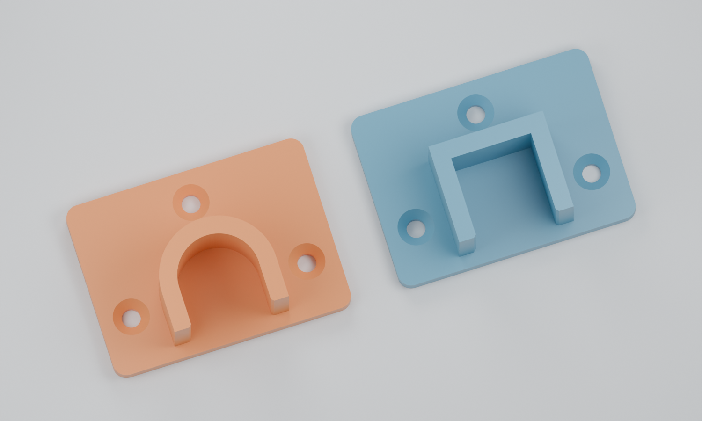

create a openSCAD script that can generate the following


einen vorhangstangenhalter / adapter. 2 stuecke koennen auf gegenueberliegenden seiten eines schrankes montiert werden. danach kann eine stange von oben eingelegt werden.

mache eine version passend fuer eine runde stange
aber auch eine eckige version fuer eine eckige stange.

standardsettings sind fuer eine eckige 18x18 mm holz stange.
das teil soll 3d fdm gedruckt werden koennen.
verwende eine toleranz von etwa 0.5mm ,das heisst wenn das holzprofil 18x18 mm ist, mache 18.5x18.5mm


images for reference are in the folder

## Umsetzung

Die Datei [`vorhangstangeschrankadapter.scad`](vorhangstangeschrankadapter.scad)
erzeugt einen oben offenen Halter mit Rueckplatte und drei versenkten
Schraubloechern. Sie benoetigt keine externen OpenSCAD-Bibliotheken.
Zwei identische Teile werden an gegenueberliegenden Schrank-Innenseiten
montiert; die Stange laesst sich anschliessend von oben einlegen.



Blau: eckige Aufnahme. Orange: runde Aufnahme. Fertige STL-Dateien mit den
Standardmassen: [eckig 18 x 18 mm](exports/halter_eckig_18x18.stl) und
[rund 18 mm](exports/halter_rund_18.stl). Fuer ein Paar dieselbe STL zweimal
im Slicer platzieren oder `layout = "pair"` im Skript verwenden.

| Parameter | Standard | Bedeutung |
| --- | --- | --- |
| `rod_shape` | `"square"` | `"square"` fuer eckige, `"round"` fuer runde Stangen |
| `rod_width`, `rod_height` | je 18 mm | Nennmasse des eckigen Profils |
| `rod_diameter` | 18 mm | Nenndurchmesser der runden Stange |
| `tolerance` | 0.5 mm | Zugabe zum gesamten Mass, nicht pro Seite |
| `socket_depth` | 20 mm | Auflagelaenge entlang der Stange |
| `wall_thickness` | 4 mm | Wandstaerke der Aufnahme |
| `plate_thickness` | 4 mm | Dicke der Rueckplatte |
| `screw_diameter` | 4.2 mm | Durchgangsloch fuer den Schraubenschaft |
| `screw_head_diameter` | 8.2 mm | Durchmesser der 90-Grad-Senkung |
| `layout` | `"single"` | `"pair"` legt zwei identische Teile nebeneinander |

Die eckige Standardaufnahme hat **18.5 mm Innenbreite und 18.5 mm
Seitenhoehe ab dem Auflageboden**, mit einer kleinen Einfuehrfase am oberen
Rand. Sie bleibt oben offen. Die runde Variante hat einen halbkreisfoermigen
Auflageboden mit nominell **18.5 mm Innendurchmesser** und geraden oberen
Seiten; auch hier ist die Oeffnung breit genug zum Einlegen von oben.
Die Aussenmasse betragen mit den Standardwerten 54.9 x 39.7 x 24 mm.

### Verwendung

In OpenSCAD oeffnen, die Parameter im Customizer anpassen, mit **F6** rendern
und als STL exportieren. Alternativ auf der Kommandozeile:

```sh
# Einzelner Halter fuer 18 x 18 mm Holz, mit 0.5 mm Gesamtspiel
openscad -o halter_eckig.stl vorhangstangeschrankadapter.scad

# Einzelner Halter fuer eine runde Stange mit 18 mm Durchmesser
openscad -o halter_rund.stl -D 'rod_shape="round"' vorhangstangeschrankadapter.scad

# Zwei eckige Halter auf einer Druckplatte
openscad -o halter_paar.stl -D 'layout="pair"' vorhangstangeschrankadapter.scad
```

### Druck und Montage

- Die flache Rueckseite liegt bereits bei Z = 0 auf dem Druckbett. Die
  Aufnahme waechst senkrecht nach oben; in dieser Orientierung sind keine
  Stuetzstrukturen vorgesehen.
- Als Ausgangspunkt: 0.2 mm Schichthoehe, 4–5 Wandlinien und 30–40 % Infill.
  Passung und Belastbarkeit am eigenen Druck pruefen.
- Je Halter drei passende Senkkopf-Holzschrauben verwenden. Schraubenlaenge
  passend zur Schrankwand waehlen; die Schrauben duerfen nicht durchstossen.
- Beide Halter auf gleicher Hoehe montieren. Die offene Seite zeigt nach
  oben (**+Y im Modell**); **+Z** zeigt von der Schrankwand zur Stange.
- Die Rueckplatten bilden die Anschlaege fuer die Stangenenden. Bei einem
  lichten Schrank-Innenmass `B` und Rueckplattendicke `p` ist der Abstand
  zwischen diesen Anschlaegen `B - 2*p`. Die Stange fuer das Einlegen etwas
  kuerzer zuschneiden, beispielsweise insgesamt 1–2 mm kuerzer. Dieses
  Laengsspiel ist unabhaengig von `tolerance`; beide Enden muessen sicher auf
  den jeweils 20 mm langen Aufnahmen liegen.

### Geometriepruefung

Mit OpenSCAD 2021.01 gerendert: beide Standardprofile, Paar-Anordnung,
24 x 12 mm Rechteck, runde 30-mm-Stange sowie kleine 5-mm-Aufnahme mit
groesseren Schraubkoepfen. Die STL-Netze sind geschlossen und haben je
Halter einen zusammenhaengenden Koerper. Fuer beide Standardprofile wurden
die 18.5-mm-Oeffnung, freie Schraubloecher und der kollisionsfreie
Einlegeweg einer 18-mm-Stange rechnerisch geprueft. Ein realer Druck- oder
Belastungstest steht noch aus.
